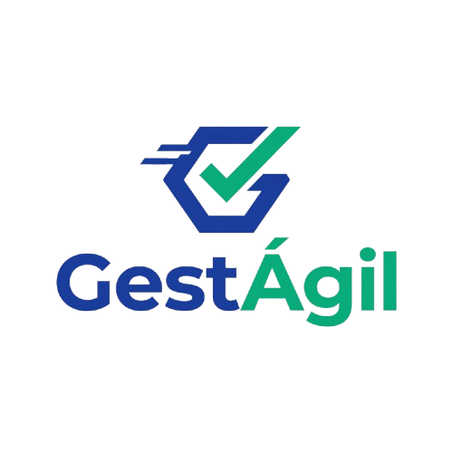
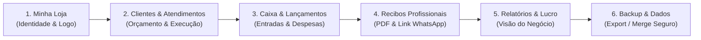

<p align="center">
  
</p>

<p align="center">
  <strong>Plataforma ágil e gratuita de gestão de caixa, atendimentos e recibos para microempreendedores e prestadores de serviços.</strong>
</p>

<p align="center">
  
  
  
  
  
  
  
</p>

---

## 📌 Sobre o GestÁgil

O **GestÁgil** é uma aplicação web de execução local (*self-hosted*), desenhada sob medida para profissionais autônomos, prestadores de serviços e Microempreendedores Individuais (MEI). 

A proposta central é eliminar de vez as anotações em cadernos, papéis soltos e planilhas confusas, oferecendo uma experiência **rápida (menos de 30 segundos no balcão)**, sem menus fiscais desnecessários e sem custos recorrentes de mensalidade de ERPs corporativos.

---

## 👤 Quem Atendemos: A Persona

<p align="center">
  
</p>

### **Márcio da Silva** (34 anos) — *"O Profissional Autônomo e Pequeno Comerciante"*

- **Contexto:** Mecânico, técnico, encanador, eletricista ou dono de uma pequena loja/oficina de bairro. Trabalha sozinho ou com auxílio de um familiar/ajudante.
- **Dispositivo Principal:** Celular Android intermediário (com uso intenso do WhatsApp) e um notebook simples no caixa/balcão.
- **Rotina:**
  - *Manhã:* Abertura, recepção de clientes e anotação rápida de serviços solicitados.
  - *Tarde:* Execução dos atendimentos com balcão movimentado e mensagens frequentes no WhatsApp solicitando orçamento e comprovante.
  - *Noite:* Fechamento do caixa tentando calcular o que entrou em dinheiro físico, Pix e cartão contra os insumos pagos. Fica sempre a dúvida: *"Tive lucro de verdade ou só paguei contas?"*.

### Como o GestÁgil transforma a rotina do Márcio:

| Dores e Frustrações do Márcio | Como o GestÁgil Soluciona |
| :--- | :--- |
| **Cadernos perdidos e contas esquecidas** | Histórico digital centralizado de clientes, serviços e valores a receber acessível em poucos toques. |
| **ERPs tradicionais caros e complicados** | Zero burocracia contábil: apenas os campos essenciais, navegação fluida em SPA e foco na agilidade. |
| **Comprovantes improvisados em texto simples** | Geração instantânea de recibos profissionais com logo, cabeçalho da loja, valor por extenso e link público. |
| **Falta de tempo para cadastros longos** | Cadastro inline de cliente em segundos; apenas o nome é obrigatório, com máscaras automáticas. |
| **Medo de perder os dados ou pagar nuvem cara** | Execução local gratuita com backup em 1 clique (.json) e restauração com mesclagem inteligente (Merge). |

---

## 🔄 Fluxos de Funcionalidade

O GestÁgil conecta todo o ciclo operacional de uma prestação de serviço ou venda, do primeiro contato ao fechamento do mês:



### 1. 🏪 Minha Loja (Identidade do Estabelecimento)
- Definição do Nome Fantasia, Razão Social, CPF/CNPJ, telefone e endereço.
- Upload da logo personalizada do negócio, estampada automaticamente em todos os recibos e relatórios impressos.
- Rodapé e mensagens de agradecimento customizadas para os clientes.

### 2. 👥 Clientes e Atendimentos
- **Cadastro Rápido:** Nome, telefone/WhatsApp (E.164), documento e observações técnicas.
- **Ciclo do Atendimento:** Agendamento do serviço com valor previsto ➔ Acompanhamento do status (`Em andamento`, `Concluído`, `Cancelado`) ➔ Conclusão com vínculo direto ao fluxo de caixa.
- Histórico completo de serviços por cliente.

### 3. 💰 Fluxo de Caixa (Lançamentos)
- Registro simplificado de **Receitas** (vinculadas ou não a atendimentos) e **Despesas** (peças, combustível, ferramentas, impostos).
- Categorização clara com tags de cores para visualização rápida.
- Formas de pagamento adaptadas ao cotidiano brasileiro: **Pix**, **Dinheiro**, **Cartão de Crédito/Débito** e **Outros**.

### 4. 📄 Emissão e Envio de Recibos Profissionais
- Emissão em 1 clique a partir de qualquer receita recebida.
- Numeração sequencial atômica por ano/usuário (`Nº 001/2026`).
- Conversão automática do valor numérico para **valor por extenso em Reais** (ex: *R$ 250,00 ➔ "duzentos e cinquenta reais"*).
- **Geração de PDF sob demanda** (< 100 ms) via DomPDF.
- **Verificação Pública:** Cada recibo gera um link seguro com UUID (`/r/{code}`) para compartilhamento direto no WhatsApp do cliente, permitindo que ele valide e baixe o PDF sem precisar de login.

### 5. 📊 Relatórios Operacionais
- Painel consolidado com entradas, saídas, saldo operacional e lucratividade do período.
- Ranking dos clientes mais recorrentes e serviços mais lucrativos.
- Comparativos mensais e anuais para tomada de decisão sem necessidade de consultoria contábil.

### 6. 🛡️ Backup e Restauração de Dados
- **Exportação Estruturada (.json):** Backup completo dos dados do usuário envelopado com UUIDs v7, garantindo portabilidade entre máquinas.
- **Restauração Inteligente com Mesclagem (Merge):** Adiciona novos registros sem duplicar clientes ou lançamentos já existentes.
- **Sobrescrita Segura com Double Check:** Substituição total de dados com confirmação explícita de segurança (digitação de `SOBRESCREVER`) e geração automática de cópia de emergência pré-restauração.

---

## 🛠️ Stack Tecnológica

| Camada | Tecnologia | Destaque |
| :--- | :--- | :--- |
| **Backend** | **PHP 8.3+** & **Laravel 11** | Arquitetura monolítica robusta, Actions especializadas, Policies e FormRequests. |
| **Frontend** | **Inertia.js 2** + **Vue 3** + **TypeScript** | Experiência fluida de SPA sem duplicar rotas ou APIs; Tailwind CSS + shadcn-vue. |
| **Banco de Dados** | **SQLite (Modo WAL)** | Zero latência de rede, concorrência otimizada com `BEGIN IMMEDIATE` e `busy_timeout`. |
| **Documentos** | **DomPDF** | Renderização rápida em memória de recibos com fontes embutidas (DejaVu). |
| **Infraestrutura** | **FrankenPHP + Docker** | Container único em produção com Caddy embutido e performance nativa. |
| **Testes** | **Pest PHP** | Mais de 60 testes automatizados cobrindo integração, regras de negócio e isolamento multi-tenant. |

---

## 🚀 Como Executar o Projeto

### Pré-requisitos
- **PHP 8.3+** e **Composer**
- **Node.js 20+** e **npm**
- *(Opcional)* **Docker** e **Docker Compose** / **Podman**

### Opção 1: Desenvolvimento Local Direto

```bash
# 1. Clonar o repositório
git clone https://github.com/seu-usuario/gestagil.git
cd gestagil

# 2. Instalar dependências PHP e JS
composer install
npm install

# 3. Configurar ambiente
cp .env.example .env
php artisan key:generate

# 4. Executar migrações do banco de dados SQLite
php artisan migrate

# 5. Compilar os assets do frontend
npm run build

# 6. Iniciar o servidor de desenvolvimento
php artisan serve
```

Acesse no seu navegador: `http://localhost:8000`

---

### Opção 2: Via Docker / Container (Ambiente Recomendado)

O projeto inclui configuração pronta com FrankenPHP:

```bash
# Iniciar o container
docker compose up -d

# Para ambiente de desenvolvimento com HMR (Vite):
docker compose -f compose.yaml -f compose.override.yaml up -d
```

Acesse em: `http://localhost:8080`

---

## 🧪 Testes Automatizados

O GestÁgil possui cobertura rigorosa de testes unitários e de feature utilizando o **Pest**:

```bash
# Executar a suíte de testes
php artisan test

# Ou via Makefile
make test
```

---

## 📚 Documentação Técnica Completa

Para aprofundar na engenharia e decisões do projeto, consulte a pasta [`docs/`](docs/):

- [`00-visao-geral.md`](docs/00-visao-geral.md) — Objetivo, escopo e premissas do TAP.
- [`01-arquitetura.md`](docs/01-arquitetura.md) — Visão arquitetural, decisões (ADRs) e trade-offs.
- [`02-requisitos.md`](docs/02-requisitos.md) — Requisitos funcionais (RF) e regras de negócio (RN).
- [`03-modelo-dados.md`](docs/03-modelo-dados.md) — Entidades, relacionamentos e migrations.
- [`04-backend-rotas.md`](docs/04-backend-rotas.md) — Rotas, controllers e camadas de serviço.
- [`05-frontend-telas.md`](docs/05-frontend-telas.md) — Telas Vue, componentes e fluxos de UX.
- [`06-infra-docker.md`](docs/06-infra-docker.md) — FrankenPHP, volumes e estratégia de deploy.
- [`11-backup-restore-estrategia.md`](docs/11-backup-restore-estrategia.md) — Estratégia de backup local e em nuvem, UUIDs e Double Check.

---

## 📄 Licença

Este projeto é disponibilizado sob a licença [MIT](LICENSE).
