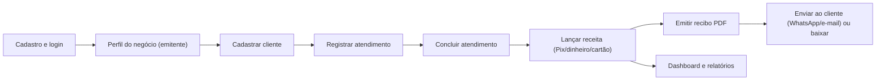

# 00 — Visão Geral

> **Projeto:** GestAgil — Gestão de Caixa e Atendimentos para Pequenos Prestadores de Serviços
> **Documento:** Planejamento macro de execução · **Versão:** 0.3 (revisão enxuta para MVP acadêmico) · **Data:** 06/11/2026
> **Fonte:** Termo de Abertura do Projeto (TAP) v1.0 · **Stack:** Laravel + Inertia.js + Vue 3 (monólito) + SQLite + Docker
> **Diretriz central:** Máxima simplicidade operacional e rapidez de entrega, mantendo segurança, coerência técnica e total aderência aos 4 módulos do TAP.

## 0. Como ler este planejamento

| Convenção | Significado |
| :--- | :--- |
| **Ponto a validar (PV-nn)** | Informação ausente ou ambígua no TAP. O planejamento adota uma hipótese provisória, sempre sinalizada. Todos os PVs estão consolidados em `09-riscos-decisoes.md`. |
| **Origem: TAP §n** | Item explicitamente presente no TAP. |
| **Origem: Proposto** | Item derivado de arquitetura/boas práticas; precisa de aceite. |
| **Prioridade (MoSCoW)** | **M** = Must (essencial ao MVP) · **S** = Should · **C** = Could · **W** = Won't. |
| **Idioma** | Documentação e interface em pt-BR; identificadores de código (tabelas, nomes de rota, classes) em inglês. Glossário na seção 10. |

### Índice dos arquivos

| Arquivo | Conteúdo |
| :--- | :--- |
| `00-visao-geral.md` | Objetivo, escopo, premissas, restrições, personas, fluxos macro |
| `01-arquitetura.md` | Arquitetura, diagrama textual, decisões (ADRs) e trade-offs |
| `02-requisitos.md` | Requisitos funcionais/não funcionais, regras de negócio, permissões |
| `03-modelo-dados.md` | Entidades, relacionamentos, campos, índices, migrations (SQLite) |
| `04-backend-rotas.md` | Rotas e controllers Laravel/Inertia, auth, validações, filas, agendamentos e integrações |
| `05-frontend-telas.md` | Páginas Inertia/Vue, layouts, telas, componentes, estado, rotas acionadas, tecnologias |
| `06-infra-docker.md` | Imagem única, compose, volumes, env, healthchecks, deploy e **plano de backup do SQLite** |
| `07-roadmap-execucao.md` | Fases, sprints, dependências, marcos, critérios de aceite |
| `08-qualidade-testes.md` | Testes, CI/CD, lint, observabilidade, segurança |
| `09-riscos-decisoes.md` | Riscos, decisões pendentes, pontos a validar, checklist final |

---

## 1. Objetivo do projeto

Desenvolver e validar uma **plataforma web responsiva** para microempreendedores e autônomos prestadores de serviços, permitindo **controle de fluxo de caixa, registro de atendimentos ponta a ponta, emissão de recibos em PDF e relatórios operacionais consolidados** (TAP §2).

### 1.1 Critérios SMART do TAP e como serão verificados

| Critério | Meta do TAP | Verificação neste planejamento |
| :--- | :--- | :--- |
| Específico | Web app com atendimentos, caixa diário, recibos PDF e relatórios de faturamento | Módulos M1–M4 (seção 3); requisitos em `02` |
| Mensurável | 100% dos 4 módulos; >90% de sucesso em testes de usabilidade; relatórios com resposta "ágil" | Protocolo de usabilidade em `08`; "ágil" quantificado como proposta em RNF-03 (**PV-26**) |
| Acordado | Validado com o orientador; critérios PMBOK das Unidades I e II | Aprovação do orientador ainda pendente no TAP (data em branco) |
| Realista | Arquitetura enxuta, nuvem gratuita, desenvolvimento solo | Capacidade de horas em `07` (**PV-13**); hospedagem R$ 0 (**PV-11**) |
| Temporal | 12 semanas | Roadmap semana a semana em `07` |

## 2. Problema e proposta de valor

- **Problema:** autônomos registram entradas/saídas em papel ou planilhas soltas → perda de histórico, descontrole financeiro, dificuldade de comprovar serviços e de fechar o mês.
- **Lacuna de mercado:** ERPs são complexos, caros e centrados em estoque/varejo; falta uma ferramenta web simples para quem vende mão de obra.
- **Proposta de valor:** registrar um atendimento ou um lançamento em poucos toques pelo celular, emitir e enviar um recibo profissional e enxergar quanto o negócio rendeu no dia/semana/mês.

## 3. Escopo

| Módulo | Entregas previstas no TAP (§5) | Complementos necessários (Origem: Proposto) |
| :--- | :--- | :--- |
| **M1 Atendimentos** | Cadastro do cliente (nome, telefone/WhatsApp); descrição do serviço; data/hora; status (em andamento, concluído, cancelado); anotações técnicas | Criação inline de cliente; listagem com busca/filtros; histórico do cliente |
| **M2 Fluxo de Caixa** | Receitas (vinculadas ou não a atendimento) e despesas (combustível, peças/insumos, ferramentas); forma de pagamento (Pix, dinheiro, cartão) | Categorias padrão e personalizadas; resumo do período (entradas, saídas, saldo) |
| **M3 Comprovantes** | Recibos PDF padronizados; download ou envio via WhatsApp/e-mail | Perfil do emitente (dados do prestador); numeração sequencial; cancelamento; link temporário assinado |
| **M4 Relatórios e Dashboard** | Faturamento líquido diário/semanal/mensal; histórico de atendimentos por período; clientes mais recorrentes | Faturamento anual (apoio à declaração — citado nos benefícios do TAP §1) |
| **Fundação** *(não listada no TAP, mas indispensável)* | — | Conta/autenticação, configurações, LGPD (termos, exclusão), infraestrutura Docker, CI |
| **Documentação PMBOK** | TAP, EAP, Cronograma, Matriz de Riscos, Plano de Comunicação, Relatório Final | Este planejamento alimenta EAP, cronograma e riscos (ver `07`, seção 6) |

## 4. Fora do escopo

**Conforme o TAP (§6):**

- Emissão de NFS-e via webservice de prefeituras (apenas recibos e ordens de serviço simplificadas).
- Gateway de processamento de cartão (apenas registro de que o pagamento ocorreu).
- Controle complexo de inventário; multi-filial/multi-caixa.
- Operação offline (a aplicação exige internet).
- Aplicativos nativos Android/iOS em lojas.

**Sugestão deste planejamento (Origem: Proposto — validar):**

- Agenda/calendário com lembretes e notificações push.
- Catálogo de serviços/produtos, orçamentos e propostas.
- Multiusuário por conta (equipe) e permissões granulares.
- Integração oficial com WhatsApp Business API.
- Importação de dados de planilhas.

## 5. Premissas

| # | Premissa | Origem |
| :--- | :--- | :--- |
| P1 | Desenvolvedor disponível ~12 h/semana | TAP §7 |
| P2 | Infraestrutura de desenvolvimento e contas gratuitas em nuvem disponíveis | TAP §7 |
| P3 | Usuários de teste têm dispositivo com navegador moderno e internet | TAP §7 |
| P4 | Frameworks open source; custo direto zero | TAP §7 |
| P5 | Cada prestador é **dono isolado** dos seus dados (nenhum dado compartilhado entre contas) | Proposto (**PV-01**) |
| P6 | Moeda única (BRL), idioma pt-BR, fuso America/Recife | Proposto (**PV-10**) |
| P7 | Recibo é documento **não fiscal**; a interface deixa isso explícito | Proposto (**PV-15**) |
| P8 | Existe ao menos um domínio/subdomínio utilizável para TLS e e-mail | Proposto (**PV-11, PV-12**) |

## 6. Restrições

| # | Restrição | Origem |
| :--- | :--- | :--- |
| R1 | Prazo: 12 semanas, encerrando na última semana da Unidade II | TAP §8, §11 |
| R2 | Orçamento financeiro R$ 0,00 | TAP §8 |
| R3 | Equipe individual (1 gerente/desenvolvedor) | TAP §8 |
| R4 | Conformidade com a LGPD nos dados de contato de clientes | TAP §8 |
| R5 | Stack definida: Laravel + Inertia.js + Vue 3 (monólito), SQLite, Docker, sem Redis | Definida pelo autor (revisão de 29/09/2026) |
| R6 | Somente ferramentas open source e camadas gratuitas | TAP §7, §12 |
| R7 | Entregáveis PMBOK competem por horas com o desenvolvimento | TAP §5, §11 |
| R8 | SQLite exige **disco persistente** e backup consistente (`VACUUM INTO`); um escritor por vez | Consequência da stack (**PV-11**, **PV-25**) |

## 7. Partes interessadas (resumo)

| Parte | Papel no software | Envolvimento |
| :--- | :--- | :--- |
| Victor Giuliano (gerente/desenvolvedor) | Todas as funções; operador da plataforma | Integral |
| Professor orientador (patrocinador acadêmico) | Não usa o sistema; avalia | Validação nas Unidades I e II |
| Prestadores de serviço (usuários-alvo) | Usuários principais | Testes de usabilidade e validação de regras |
| Coordenação/IFPE | Infraestrutura e calendário acadêmico | Indireto |
| Clientes finais dos prestadores | Recebem recibos; **não** têm conta | Passivo (link/PDF) |

## 8. Personas (proto-personas — hipóteses a validar com os usuários-alvo)

> O TAP cita categorias de profissionais, mas não define personas. Os perfis abaixo são hipóteses de trabalho para orientar UX e prioridades. **PV-27.**

| Persona | Perfil | Dores | Necessidade principal no GestAgil |
| :--- | :--- | :--- | :--- |
| **Marcos — eletricista autônomo** | 38 anos, Android, WhatsApp intenso, anota serviços em caderno | Esquece de cobrar; perde comprovantes; mistura gastos pessoais e do trabalho | Lançar receita/despesa em segundos e mandar recibo ao cliente no WhatsApp |
| **Aline — esteticista/manicure** | 29 anos, atende com hora marcada, controla agenda no WhatsApp | Não sabe quanto lucrou no mês; clientes recorrentes sem histórico | Histórico por cliente e resumo mensal claro |
| **Rafael — técnico de manutenção** | 45 anos, usa notebook e celular; compra peças e paga combustível | Despesas de peças/deslocamento sem registro; precisa provar o serviço feito | Anotações técnicas por atendimento, despesas categorizadas, recibo com descrição do serviço |
| **Victor — operador da plataforma** | Desenvolvedor e gestor do projeto | Depurar problemas de usuários, garantir LGPD e backups | Logs, healthchecks, auditoria mínima |

## 9. Fluxos macro

### 9.1 Jornada principal do prestador

### 9.2 Fluxos detalhados

| ID | Fluxo | Passos macro | Telas (`05`) | Regras (`02`) |
| :--- | :--- | :--- | :--- | :--- |
| F1 | **Onboarding** | Cadastro → aceite de termos → preencher perfil do negócio → checklist no dashboard | S-02, S-19, S-06 | RN-16, RN-18 |
| F2 | **Atendimento até recibo** | Novo atendimento (cliente existente ou inline) → status *em andamento* → concluir → "Registrar recebimento" (receita pré-vinculada) → "Emitir recibo" → compartilhar | S-08, S-09, S-11, S-16, S-17 | RN-04, RN-07, RN-08 |
| F3 | **Lançamento rápido** | Botão flutuante "+" → Receita/Despesa → valor, forma de pagamento, categoria → salvar | S-11, S-10 | RN-02, RN-03 |
| F4 | **Recibo avulso** | Receita sem atendimento (cliente opcional) → emitir recibo informando pagador | S-11, S-16 | RN-08 |
| F5 | **Fechamento do mês** | Relatórios → período mensal → faturamento líquido, categorias, clientes recorrentes | S-18 | RN-11, RN-12 |
| F6 | **Correção/cancelamento** | Cancelar atendimento (motivo) · cancelar recibo (motivo) · editar/excluir lançamento sem recibo | S-09, S-17, S-11 | RN-05, RN-09, RN-22 |
| F7 | **LGPD** | Editar/excluir cliente · excluir conta e todos os dados | S-14, S-20 | RN-16 |
| F8 | **Recuperação de acesso** | Esqueci a senha → e-mail com link → redefinir → login | S-03, S-04, S-01 | RN-17 |

## 10. Glossário (pt-BR ↔ código)

| Termo de negócio | Entidade/tabela | Rota (URL) | Observação |
| :--- | :--- | :--- | :--- |
| Prestador (usuário) | `users` | `/configuracoes/conta` | Dono dos dados |
| Perfil do negócio / emitente | `business_profiles` | `/configuracoes/negocio` | Cabeçalho do recibo |
| Cliente | `clients` | `/clientes` | Cliente do prestador |
| Atendimento | `appointments` | `/atendimentos` | Ordem de serviço simplificada |
| Lançamento | `transactions` (`income`/`expense`) | `/caixa` | Receita ou despesa |
| Categoria | `transaction_categories` | `/configuracoes/categorias` | Por usuário |
| Recibo / comprovante | `receipts` | `/recibos` | Documento imutável (snapshot) |
| Faturamento líquido | — | `/relatorios/faturamento` | Receitas − despesas (**PV-08**) |

## 11. Lacunas e ambiguidades do TAP identificadas

| # | Lacuna | Impacto | Hipótese adotada | PV |
| :--- | :--- | :--- | :--- | :--- |
| 1 | Perfis de acesso não definidos | Autorização | Um perfil "Prestador" (dono dos dados); Admin opcional e mínimo | PV-01 |
| 2 | "Data/hora" do atendimento: agendado ou realizado? Existe agenda? | Modelo e UX | Data/hora do serviço (pode ser futura); sem agenda/lembretes | PV-02 |
| 3 | Atendimento tem valor? | Modelo e relatórios | Sem valor obrigatório; valor vem dos lançamentos | PV-03 |
| 4 | Relação recibo ↔ lançamento/atendimento | Modelo e regras | Um recibo por lançamento de receita (1:1) | PV-04 |
| 5 | "Envio direto" por WhatsApp sem API oficial | Integração | Web Share API + link `wa.me` + URL assinada | PV-05 |
| 6 | Justificativa cita inadimplência; escopo não prevê "a receber" | Modelo e telas | Lançamentos sempre realizados no MVP; campo `status` reservado | PV-06 |
| 7 | "Cartão" sem distinção crédito/débito | Relatórios | Uma opção "Cartão" + "Outro" | PV-07 |
| 8 | "Faturamento líquido" não definido | Relatórios | Receitas − despesas, regime de caixa | PV-08 |
| 9 | "Cliente recorrente" não definido | Relatórios | ≥ 2 atendimentos concluídos no período; ranking por quantidade | PV-09 |
| 10 | Semana e fuso horário | Relatórios | Semana ISO (segunda a domingo); America/Recife | PV-10 |
| 11 | Como hospedar produção com R$ 0 | Infra | Docker Compose em VPS/máquina com **disco persistente** (exigência do SQLite); a confirmar | PV-11 |
| 12 | E-mail transacional sem custo | Integração | SMTP com plano gratuito; Mailpit em dev | PV-12 |
| 13 | Janela de desenvolvimento do TAP (semanas 6–9 = 48 h) é insuficiente para o escopo completo | Prazo | Iniciar Sprint 0 nas semanas 4–5; priorizar por MoSCoW | PV-13 |
| 14 | LGPD: papéis, base legal, retenção de recibos vs. exclusão | Compliance | Prestador = controlador; plataforma = operador; anonimização preserva recibos | PV-14 |
| 15 | Validade e aviso do recibo | Documento | Rodapé "não substitui nota fiscal" | PV-15 |
