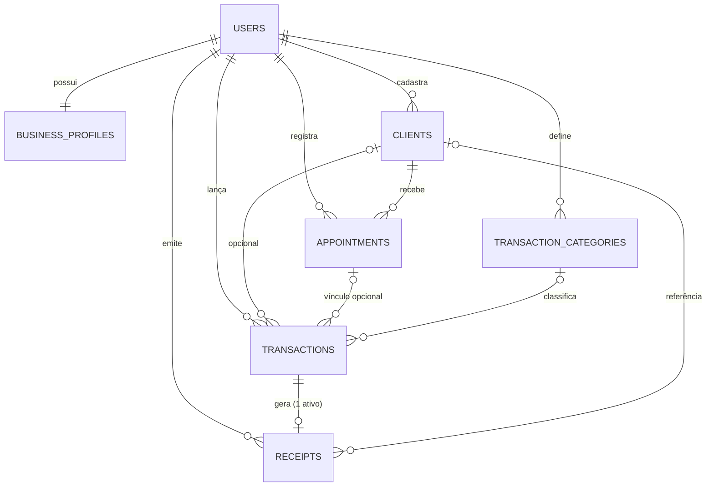

# 03 — Modelo de Dados

> **Versão:** 0.3 (revisão enxuta: 7 tabelas de domínio no SQLite) · **Data:** 06/11/2026 · Depende de: `02-requisitos.md`
> **SGBD:** SQLite em modo WAL (decisão fechada, **PV-18 resolvido**) · Nomes em inglês, `snake_case`, tabelas no plural.
> **Nota de tipos:** as tabelas abaixo usam tipos lógicos. No SQLite, `bigint` vira `integer` (64 bits), `timestamptz` vira `datetime` (texto no horário local) e `jsonb` vira `json` (texto, com *cast* no Eloquent). Os comprimentos de `varchar` são validados pela aplicação (o SQLite não os impõe).

## 1. Convenções

| Tema | Convenção |
| :--- | :--- |
| Chaves primárias | `id` inteiro autoincremental. Recibos possuem também `code` (UUID) público. |
| Escopo por usuário | Toda tabela de domínio tem `user_id` (FK, `NOT NULL`, `ON DELETE CASCADE`), indexado. **Chaves estrangeiras precisam estar ativas** (`foreign_key_constraints=true` em `config/database.php`; teste garante). |
| Dinheiro | `*_cents` inteiro. Valor positivo garantido por `CHECK` criado junto com a tabela e pelo FormRequest. Moeda implícita: BRL. |
| Datas | `occurred_on date` (dia local); instantes em `datetime` **no horário local** (`APP_TIMEZONE=America/Recife`, sem horário de verão — ADR-22). Não alterar o fuso depois de haver dados (**PV-10**). |
| Enums | Coluna `varchar` espelhada por *backed enums* PHP. Rótulos em pt-BR vivem nas páginas Vue. |
| Exclusão | `deleted_at` (soft delete) em `clients`, `appointments`, `transactions`. Recibos não são excluídos (status `canceled`). |
| Auditoria | `created_at`/`updated_at` em todas as tabelas; eventos sensíveis gravados no log estruturado da aplicação (`stderr`). |
| Unicidade "viva" | Índices únicos **parciais** (`WHERE deleted_at IS NULL`) — suportados pelo SQLite; criados por SQL bruto na migration. |
| Texto e busca | E-mails em minúsculas (normalizados na aplicação). `clients` tem a coluna `search_name` (minúsculas, sem acento), preenchida pelo Model; adicionalmente, registra-se a UDF `unaccent()` na conexão SQLite do Laravel para permitir buscas sem acento também na descrição de atendimentos (**PV-30**). |
| Concorrência | Um escritor por vez. WAL, `busy_timeout=5000` e transações de escrita imediata (`BEGIN IMMEDIATE`) configurados em `config/database.php` (ver `06`). |

## 2. Diagrama entidade-relacionamento

## 3. Entidades e campos (7 tabelas de domínio)

### 3.1 `users`

| Campo | Tipo | Regras |
| :--- | :--- | :--- |
| id | integer PK | |
| name | varchar(120) | obrigatório |
| email | varchar(190) | único (minúsculas), obrigatório |
| password | varchar(255) | hash (bcrypt/argon2) |
| terms_accepted_at | datetime | ciência dos termos e privacidade no cadastro (RN-16) |
| remember_token, created_at, updated_at | — | padrão Laravel |

### 3.2 `business_profiles` (1:1 com `users`)

| Campo | Tipo | Regras |
| :--- | :--- | :--- |
| id | integer PK | |
| user_id | integer FK **único** | |
| display_name | varchar(150) | nome/razão social do emitente |
| trade_name | varchar(150) null | nome fantasia |
| document_type | varchar(4) null | `cpf` \| `cnpj` |
| document_number | varchar(14) null | somente dígitos; obrigatório para emitir (**PV-15**) |
| phone | varchar(20) null | E.164 |
| email | varchar(190) null | |
| postal_code, address_line, address_number, district, city | varchar | opcionais |
| state | char(2) null | UF |
| logo_path | varchar(255) null | arquivo privado |
| receipt_footer | varchar(500) null | rodapé padrão |
| timestamps | | |

### 3.3 `clients`

| Campo | Tipo | Regras |
| :--- | :--- | :--- |
| id | integer PK | |
| user_id | integer FK | |
| name | varchar(150) | obrigatório |
| search_name | varchar(150) | minúsculas e sem acento, derivado de `name` (busca; **PV-30**) |
| phone_e164 | varchar(20) | obrigatório (telefone/WhatsApp — TAP §5) |
| email | varchar(190) null | |
| document_number | varchar(14) null | CPF/CNPJ (dígitos) |
| notes | text null | |
| deleted_at, timestamps | | soft delete |

### 3.4 `appointments`

| Campo | Tipo | Regras |
| :--- | :--- | :--- |
| id | integer PK | |
| user_id | integer FK | |
| client_id | integer FK → clients | `RESTRICT`; obrigatório |
| service_description | text | obrigatório |
| service_at | datetime | data/hora do atendimento (**PV-02**) |
| status | varchar(15) | `in_progress` \| `completed` \| `canceled` (padrão `in_progress`) |
| technical_notes | text null | |
| expected_amount_cents | integer null | valor previsto (**PV-03**, opcional) |
| completed_at | datetime null | preenchido ao concluir |
| canceled_at | datetime null | |
| cancel_reason | varchar(500) null | |
| deleted_at, timestamps | | soft delete |

### 3.5 `transaction_categories`

| Campo | Tipo | Regras |
| :--- | :--- | :--- |
| id | integer PK | |
| user_id | integer FK | categorias padrão são **copiadas por usuário** no cadastro |
| name | varchar(60) | obrigatório |
| name_key | varchar(60) | minúsculas sem acento, para unicidade (RN-20) |
| type | varchar(7) | `income` \| `expense` |
| is_default | boolean | padrão `false` |
| archived_at | datetime null | RN-20 |
| timestamps | | |

Sementes por usuário — **Receitas:** Serviço prestado, Venda de peças/materiais, Outros. **Despesas:** Combustível/deslocamento, Peças e insumos, Ferramentas e equipamentos, Impostos/taxas, Marketing, Outros.

### 3.6 `transactions` (lançamentos)

| Campo | Tipo | Regras |
| :--- | :--- | :--- |
| id | integer PK | |
| user_id | integer FK | |
| type | varchar(7) | `income` \| `expense` |
| amount_cents | integer | `CHECK (amount_cents > 0)` |
| occurred_on | date | dia do lançamento (RN-03) |
| description | varchar(255) | obrigatório |
| category_id | integer FK null | mesma `type` do lançamento |
| payment_method | varchar(10) | `pix` \| `cash` \| `card` \| `other` (**PV-07**) |
| appointment_id | integer FK null | somente receitas; `RESTRICT` |
| client_id | integer FK null | herdado do atendimento quando houver (RN-07) |
| notes | text null | |
| deleted_at, timestamps | | soft delete |

Restrições adicionais: `CHECK (type = 'income' OR appointment_id IS NULL)`.

### 3.7 `receipts`

| Campo | Tipo | Regras |
| :--- | :--- | :--- |
| id | integer PK | |
| user_id | integer FK | |
| transaction_id | integer FK → transactions | `RESTRICT`; único parcial para status `issued` (RN-08) |
| client_id | integer FK null | referência informativa (o snapshot é a fonte) |
| code | uuid | público, único (verificação e download em `/r/{code}`) |
| year | smallint | ano de emissão |
| number | integer | sequencial por (`user_id`, `year`), exibido como `NNNN/AAAA` (RN-19); calculado atomicamente via `COALESCE(MAX(number), 0) + 1` dentro de transação `BEGIN IMMEDIATE` |
| status | varchar(10) | `issued` \| `canceled` |
| issued_at | datetime | |
| amount_cents | integer | snapshot |
| payment_method | varchar(10) | snapshot |
| description | varchar(500) | snapshot |
| payer_name | varchar(150) | snapshot obrigatório |
| payer_document | varchar(14) null | snapshot |
| issuer_snapshot | json | nome, documento, contato, endereço, logo no momento da emissão |
| canceled_at | datetime null | |
| cancel_reason | varchar(500) null | |
| timestamps | | |

*(Nota de simplificação: as tabelas `receipt_sequences`, `receipt_deliveries` e `audit_logs` foram removidas. A sequência usa `MAX(number) + 1` protegido pelo índice único `(user_id, year, number)` pois recibos nunca sofrem delete; o PDF é gerado sob demanda a partir do snapshot em < 100 ms; e logs de auditoria vão para `stderr`.)*

### 3.8 Tabelas de infraestrutura Laravel

Apenas `password_reset_tokens` e `migrations`. Sessão e cache usam arquivos (`file`) no volume `app-storage`, e a fila usa `sync`/`defer`, portanto **não há tabelas `sessions`, `cache` nem `jobs`** disputando escrita no SQLite.

## 4. Relacionamentos e Regra de Exclusão de Conta

| Origem | Destino | Cardinalidade | Regra de exclusão |
| :--- | :--- | :--- | :--- |
| users | business_profiles | 1:1 | CASCADE |
| users | clients / appointments / transactions / categories / receipts | 1:N | Exclusão em ordem reversa pela Action `DeleteAccount` |
| clients | appointments | 1:N | RESTRICT (cliente com histórico é apenas arquivado via soft delete) |
| clients | transactions | 1:N (opcional) | SET NULL |
| appointments | transactions | 1:N (opcional) | RESTRICT |
| transaction_categories | transactions | 1:N (opcional) | RESTRICT (categoria em uso é arquivada) |
| transactions | receipts | 1:0..1 ativo | RESTRICT |

**Atenção técnica (`DeleteAccount` no SQLite):** como existem constraints `ON DELETE RESTRICT` entre tabelas filhas (`receipts` → `transactions` → `appointments` → `clients`), um `DELETE FROM users` direto no SQLite falhará se o motor tentar apagar `clients` antes de `appointments`. Portanto, a Action `DeleteAccount` **deve** excluir explicitamente na ordem topológica reversa dentro de uma transação:
`receipts` → `transactions` → `appointments` → `transaction_categories` → `clients` → `business_profiles` → `users`.

## 5. Índices

| Tabela | Índice | Finalidade |
| :--- | :--- | :--- |
| users | `UNIQUE (email)` com e-mail sempre gravado em minúsculas | Login e unicidade |
| business_profiles | `UNIQUE (user_id)` | 1:1 |
| clients | `(user_id, name)` | Listagem ordenada |
| clients | `(user_id, phone_e164)` (**não único**) | Busca por telefone e aviso de duplicidade (**PV-29**) |
| clients | `(user_id, search_name)` | Busca por nome sem acento |
| appointments | `(user_id, service_at DESC)` | Listagem e relatório por período |
| appointments | `(user_id, status, service_at DESC)` | Filtro por status |
| appointments | `(user_id, client_id, service_at DESC)` | Histórico do cliente e ranking |
| transactions | `(user_id, occurred_on DESC, id DESC)` | Listagem por período |
| transactions | `(user_id, type, occurred_on)` | Resumo e faturamento |
| transactions | `(user_id, category_id, occurred_on)` | Relatório por categoria |
| transactions | `(user_id, appointment_id)` | Lançamentos do atendimento |
| transaction_categories | `UNIQUE (user_id, type, name_key) WHERE archived_at IS NULL` | RN-20 |
| receipts | `UNIQUE (user_id, year, number)` | Numeração sequencial única |
| receipts | `UNIQUE (code)` | Verificação pública |
| receipts | `UNIQUE (transaction_id) WHERE status = 'issued'` | 1 recibo ativo por receita |
| receipts | `(user_id, issued_at DESC)` | Listagem |

## 6. Migrations em nível macro (ordem de criação corrigida)

| # | Migration | Conteúdo | Sprint (`07`) |
| :--- | :--- | :--- | :--- |
| 1 | `create_users_table` (+ `password_reset_tokens`) | `users` com `terms_accepted_at` | S0/S1 |
| 2 | `create_business_profiles_table` | Criada já no S1 para suportar criação de perfil vazio no registro | **S1** |
| 3 | `create_transaction_categories_table` | Criada já no S1 para suportar a semeadura de categorias padrão no registro | **S1** |
| 4 | `create_clients_table` | + `search_name` e índices | **S1** |
| 5 | `create_appointments_table` | + CHECK de status | S2 |
| 6 | `create_transactions_table` | + CHECKs e índices | S3 |
| 7 | `create_receipts_table` | + únicos parciais | S4 |

**Cuidados do SQLite nas migrations:** `CHECK` e chaves estrangeiras devem ser definidos já na criação de cada tabela. Índices parciais usam `DB::statement` dentro da migration. Rodar as migrations **sempre depois de um backup** (ver `06`).

## 7. Dados, volume e ciclo de vida

| Item | Estimativa/Política |
| :--- | :--- |
| Volume por usuário ativo | ~20 atendimentos, ~40 lançamentos e ~20 recibos/mês → < 5.000 lançamentos/usuário em 2 anos |
| Tamanho de PDF | ~30–80 KB gerado em memória sob demanda (não ocupa disco) |
| Exclusão de conta | Remove dados de todas as tabelas (em ordem topológica reversa) e logo do usuário |
| Backups | Diário via `VACUUM INTO` + `gzip`, mantendo últimos 14 dias; backup automático antes de cada deploy — detalhes em `06` |
