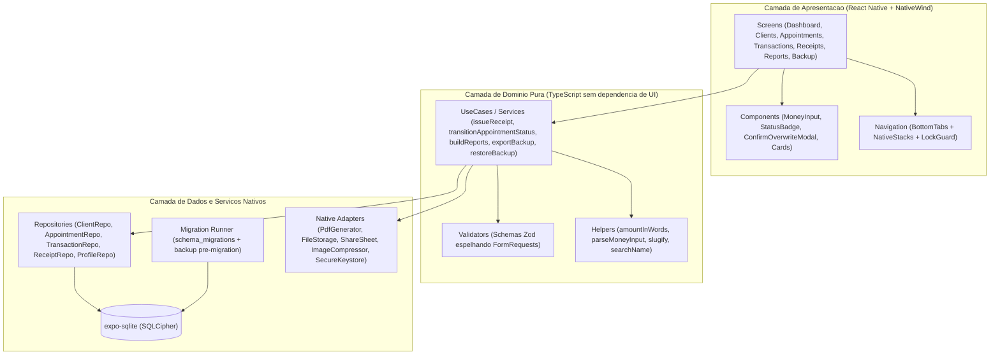
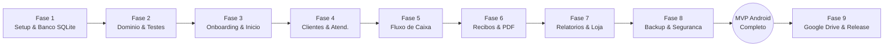

# 12 — Plano de Ação: Aplicativo Android do GestÁgil (React Native · 100% Local)

> **Versão:** 3.0 (Decisões Consolidadas) · **Data:** 08/11/2026 · **Status:** Pronto para execução em repositório próprio
> **Premissa central:** o aplicativo Android é **100% autônomo (local-first / standalone)**, desenvolvido em **React Native (Expo + TypeScript)** em repositório separado. Todos os dados ficam armazenados no próprio celular do empreendedor (SQLite local) e toda a regra de negócio roda no dispositivo.

---

## 0. Kit de Documentação da Migração Mobile

Este documento é o **Plano Diretor**. Para que o novo repositório do app possa ser construído do zero sem depender de leitura do código PHP/Vue, a especificação completa foi dividida em 5 documentos complementares:

| Documento | Conteúdo |
| :--- | :--- |
| **[`12-plano-app-android.md`](12-plano-app-android.md)** *(este arquivo)* | Decisões fechadas, stack React Native, arquitetura em camadas, roadmap de fases, testes e publicação |
| **[`13-migracao-modelo-dados.md`](13-migracao-modelo-dados.md)** | Esquema SQLite local completo (DDL sem `user_id`), sementes de categorias, enums, `issuer_snapshot` e motor de migrations no aparelho |
| **[`14-migracao-regras-negocio.md`](14-migracao-regras-negocio.md)** | Todas as regras de negócio extraídas do backend Laravel: validações, máquina de estados RN-04, numeração de recibos, algoritmo de valor por extenso, layout do PDF e queries de relatórios |
| **[`15-migracao-contrato-backup.md`](15-migracao-contrato-backup.md)** | Especificação do arquivo `.json` de backup (ponte web <-> mobile), algoritmos de Merge e Replace com Double Check e correções de contrato |
| **[`16-migracao-telas-navegacao.md`](16-migracao-telas-navegacao.md)** | Mapeamento de todas as telas web para React Native, árvore de navegação (Bottom Tabs + Stacks), Design System, fluxos de modais e integrações nativas Android |

---

## 1. Decisões Arquiteturais Consolidadas

Todas as questões estruturais foram decididas e estão refletidas neste plano:

| # | Tema | Decisão Fechada | Impacto Técnico |
| :--- | :--- | :--- | :--- |
| **D-01** | **Arquitetura de Execução** | **100% Local no Aparelho** (sem servidor, sem API REST, sem sincronização cliente-servidor) | O SQLite roda dentro do Android; toda a lógica de domínio (recibos, caixa, relatórios, PDF) é executada localmente em TypeScript |
| **D-02** | **Titularidade por Aparelho** | **Titular Único por Dispositivo** | Elimina tabela `users`, `user_id` e escopos multi-tenant no banco mobile. Substituído pela tabela `owner` (1 linha) e bloqueio local opcional (PIN/biometria) |
| **D-03** | **Verificação Pública de Recibo** | **Descartada nesta versão** | As rotas públicas `/r/{code}` não existem no mobile. O recibo em PDF mantém o código UUID impresso (`Chave de Autenticidade Digital`), sem URL pública |
| **D-04** | **Repositório do Projeto** | **Repositório Separado (`gestagil-mobile`)** | Ciclo de build, dependências Node/Android e CI independentes. A interoperabilidade com a versão web ocorre pelo contrato JSON de backup (`15`) |
| **D-05** | **Stack Mobile** | **React Native (com Expo Prebuild / Development Builds + TypeScript)** | Ecossistema maduro para SQLite nativo (com SQLCipher), geração de PDF, compartilhamento no WhatsApp e estilização consistente |

---

## 2. Stack Tecnológica Definida (React Native)

Uso do **Expo SDK (fluxo Continuous Native Generation / `expo prebuild`)**, que permite configurar binários nativos (como SQLCipher) via `app.json` mantendo simplicidade de manutenção.

| Camada | Biblioteca / Pacote | Papel no GestÁgil Mobile |
| :--- | :--- | :--- |
| **Core & Linguagem** | `react-native` + `expo` + `typescript` | Base do aplicativo Android com tipagem estrita |
| **Navegação** | `@react-navigation/native` (`bottom-tabs` + `native-stack`) ou `expo-router` | Navegação por abas inferiores (`Início`, `Clientes`, `Atendimentos`, `Caixa`, `Mais`) e pilhas de telas (`16`) |
| **Estilização** | `nativewind` (Tailwind CSS para RN) | Reaproveita os mesmos tokens de cor (`indigo-600`, `emerald-600`, `rose-600`, `amber-100`) da identidade visual web (`16`) |
| **Banco de Dados Local** | `expo-sqlite` (com plugin `useSQLCipher: true`) | SQLite local criptografado (AES-256) com API síncrona/assíncrona moderna e transações atômicas |
| **Armazenamento de Chaves** | `expo-secure-store` | Guarda a chave de criptografia do SQLCipher e o hash do PIN no Android Keystore |
| **Validação e Formulários** | `react-hook-form` + `zod` | Validação idêntica aos FormRequests do Laravel com mensagens em pt-BR (`14`) |
| **Gerenciamento de Estado** | `zustand` ou `@tanstack/react-query` | Estado global leve (sessão de bloqueio, dados da loja) e invalidação de consultas SQLite |
| **Geração de PDF** | `expo-print` | Renderiza o template HTML/CSS do recibo (`14`, seção 7) em arquivo PDF A4 paginado nativamente no Android |
| **Compartilhamento e Arquivos** | `expo-sharing` + `expo-file-system` + `expo-document-picker` | Envio de recibos PDF pelo WhatsApp, exportação e importação de arquivos de backup `.json` |
| **Imagens (Logo da Loja)** | `expo-image-picker` + `expo-image-manipulator` | Captura da câmera/galeria e compressão para no máximo `800x800 px` e `< 2 MB` (`14`, seção 11) |
| **Segurança / Biometria** | `expo-local-authentication` | Desbloqueio opcional do app por impressão digital / reconhecimento facial do Android |
| **Datas e Moeda** | `date-fns` (`pt-BR`) + `Intl.NumberFormat` | Formatação de datas locais e valores monetários em BRL |
| **Testes** | `jest` + `@testing-library/react-native` + `maestro` (E2E) | Testes unitários da camada de domínio e testes fim a fim no emulador Android |

---

## 3. Arquitetura Interna do Aplicativo



### 3.1 Estrutura de Diretórios do Novo Repositório (`gestagil-mobile`)

```
gestagil-mobile/
├── app.json                         # Config do Expo (inclui plugin expo-sqlite com useSQLCipher: true)
├── package.json
├── tsconfig.json
├── assets/
│   ├── gestagil-logo-removegb.png   # Copiado de assets/ deste repositório
│   └── gestagil-icon-removebg.png   # Ícone do app e adaptive icon Android
├── src/
│   ├── db/
│   │   ├── client.ts                # Inicialização do SQLite + SQLCipher + PRAGMA foreign_keys = ON
│   │   ├── migrationRunner.ts       # Executor transacional de migrations com cópia de segurança
│   │   ├── seeders.ts               # Semente das 9 categorias padrão (DefaultCategoriesSeeder)
│   │   ├── migrations/
│   │   │   └── 0001_initial.ts      # DDL completa especificada no doc 13
│   │   └── repositories/
│   │       ├── ownerRepository.ts
│   │       ├── businessProfileRepository.ts
│   │       ├── categoryRepository.ts
│   │       ├── clientRepository.ts
│   │       ├── appointmentRepository.ts
│   │       ├── transactionRepository.ts
│   │       ├── receiptRepository.ts
│   │       └── reportRepository.ts
│   ├── domain/
│   │   ├── enums/
│   │   │   ├── AppointmentStatus.ts # in_progress, completed, canceled + canTransitionTo (RN-04)
│   │   │   └── PaymentMethod.ts     # pix, cash, card, other
│   │   ├── validators/              # Schemas Zod com mensagens idênticas ao Laravel (doc 14)
│   │   ├── support/
│   │   │   ├── amountInWords.ts     # Conversão de centavos para extenso (doc 14, seção 8)
│   │   │   ├── money.ts             # Centavos <-> BRL e normalização de entrada (doc 14, seção 2)
│   │   │   └── text.ts              # slug() para name_key e normalizeSearchName()
│   │   └── services/
│   │       ├── receiptService.ts    # Emissão atômica, numeração anual, issuer_snapshot e cancelamento
│   │       ├── backupExportService.ts
│   │       └── backupRestoreService.ts # Merge e Replace com Double Check e snapshot de segurança
│   ├── native/
│   │   ├── pdfReceiptGenerator.ts   # Template HTML do recibo + expo-print + expo-sharing
│   │   ├── imageOptimizer.ts        # Redimensionamento 800x800 e limite 2MB
│   │   └── securityLock.ts          # PIN + biometria via expo-local-authentication
│   ├── navigation/
│   │   ├── RootNavigator.tsx
│   │   └── MainTabNavigator.tsx
│   ├── components/                  # Botões, inputs monetários, cards, modais
│   └── screens/                     # Telas mapeadas no doc 16
└── __tests__/
    ├── domain/
    │   ├── amountInWords.test.ts    # Casos de referência idênticos ao AmountInWordsTest.php
    │   ├── appointmentStatus.test.ts
    │   ├── receiptService.test.ts
    │   └── backupRoundTrip.test.ts  # Casos 1 a 15 do doc 15
    └── e2e/                         # Fluxos Maestro (.yaml)
```

---

## 4. Roadmap de Execução (Passo a Passo)

O desenvolvimento está organizado em **9 Fases sequenciais**, desenhadas para entregar valor incremental e permitir validação contínua no aparelho/emulador Android.



### Fase 1 — Fundação, Projeto Expo e Camada SQLite
- **Objetivo:** Inicializar o repositório `gestagil-mobile`, configurar NativeWind, gerar o build de desenvolvimento Android (`npx expo prebuild`) com `expo-sqlite` (`useSQLCipher: true`) e `expo-secure-store`.
- **Entregas:**
  - Conexão com chave criptográfica gerada e persistida no Android Keystore.
  - `migrationRunner.ts` aplicando a `0001_initial` (DDL exata do documento `13`).
  - Semente idempotente das 9 categorias padrão (`13`, seção 4.3).
- **Critério de Aceite:** App abre no emulador/aparelho, cria o banco criptografado, executa a migration 0001 com `PRAGMA foreign_keys = ON` e semeia as categorias.

### Fase 2 — Camada de Domínio Pura e Suíte de Paridade
- **Objetivo:** Implementar em TypeScript todas as funções de negócio especificadas no documento `14` antes de construir formulários.
- **Entregas:**
  - `amountInWords.ts`, `money.ts` (normalização de entrada monetária), `text.ts` (`slug` e `search_name`).
  - Enum `AppointmentStatus` com `canTransitionTo` (RN-04) e `PaymentMethod`.
  - Schemas Zod para Cliente, Atendimento, Lançamento, Emissão/Cancelamento de Recibo e Perfil da Loja.
  - Repositórios SQLite para todas as tabelas respeitando `deleted_at IS NULL` nas listagens e `withTrashed` (sem filtro) ao exibir vínculos históricos.
- **Critério de Aceite:** Suíte Jest passando 100% dos casos de referência do documento `14` (seções 2, 4.2, 8.2).

### Fase 3 — Navegação, Onboarding, Bloqueio e Dashboard (Início)
- **Objetivo:** Construir a casca de navegação (`16`, seção 1), o fluxo de primeiro acesso e a tela inicial.
- **Entregas:**
  - Telas `Onboarding/Welcome` e `Onboarding/Setup` (nome do titular, aceite obrigatório dos termos RN-16, opção de restaurar backup logo na entrada e criação opcional de PIN).
  - Telas estáticas `Legal/Terms` e `Legal/Privacy` embarcadas offline.
  - `LockScreen` (PIN/biometria) exibida ao abrir o app quando habilitada.
  - Aba `Início` (`Dashboard`) com checklist de 3 passos, cards de resumo do mês, atalhos 2x2 e listas de recentes (`16`, seção 3.2).
- **Critério de Aceite:** Fluxo de primeiro acesso conclui onboarding, semeia categorias e exibe o Dashboard com métricas zeradas e checklist em 0%.

### Fase 4 — Módulo de Clientes e Atendimentos (M1)
- **Objetivo:** Entregar os fluxos de cadastro rápido de clientes e gestão ponta a ponta de ordens de serviço.
- **Entregas:**
  - Telas `Clients/Index` (busca com debounce de 300ms por `search_name`, documento ou telefone), `Create`, `Edit` e `Show` (com deep link `wa.me` para WhatsApp e `mailto:`).
  - Telas `Appointments/Index` (busca e filtro por chips de status), `Create` (com criação rápida de cliente), `Edit` (bloqueada se não estiver `in_progress`) e `Show`.
  - Ações de conclusão (`completed_at`) e cancelamento com modal de motivo (`cancel_reason`).
- **Critério de Aceite:** Cadastrar cliente, agendar atendimento, concluir atendimento e acionar o botão "Lançar Recebimento no Caixa" em menos de 30 segundos.

### Fase 5 — Módulo de Fluxo de Caixa (M2)
- **Objetivo:** Controlar receitas e despesas com cálculo instantâneo de saldo mensal.
- **Entregas:**
  - Telas `Transactions/Index` (filtro por mês `YYYY-MM` e por tipo, 3 cards de resumo mensal) e `Transactions/Create`.
  - Pré-preenchimento automático quando aberto a partir de um atendimento concluído (`14`, seção 5.3) e herança de `client_id`.
  - Exclusão lógica (soft delete) com atualização imediata dos totais.
- **Critério de Aceite:** Totais de entradas, saídas e resultado líquido idênticos aos da versão web para os mesmos lançamentos.

### Fase 6 — Módulo de Recibos e Geração de PDF (M3)
- **Objetivo:** Emitir recibos imutáveis com numeração sequencial por ano e compartilhamento direto em PDF.
- **Entregas:**
  - Serviço `receiptService.ts`: bloqueio para despesas, bloqueio de duplicidade ativa para o mesmo lançamento, cálculo atômico de `number` no `year` e congelamento do `issuer_snapshot` (`13`, seção 3; `14`, seção 6).
  - Gerador de PDF (`pdfReceiptGenerator.ts`) reproduzindo o layout de `receipt.blade.php` (`14`, seção 7) via `expo-print`, incluindo logo em base64 e tarja `CANCELADO` quando aplicável.
  - Compartilhamento nativo via `expo-sharing` (WhatsApp, e-mail, Drive).
- **Critério de Aceite:** Emitir recibo `0001/2026`, gerar o PDF `recibo-0001-2026.pdf` e compartilhá-lo no WhatsApp com logotipo e valor por extenso corretos.

### Fase 7 — Relatórios Operacionais (M4) e Minha Loja
- **Objetivo:** Dar visibilidade gerencial ao empreendedor e personalizar os comprovantes.
- **Entregas:**
  - Tela `More/Reports` com as 4 visões (`Faturamento`, `Atendimentos`, `Ranking de Clientes`, `Desempenho Anual`) e seletores de período (`14`, seção 10; `16`, seção 3.7).
  - Tela `More/BusinessProfile` com captura de logo (câmera/galeria), compressão (`800x800 px`, `< 2 MB`) e todos os campos cadastrais e de endereço (`14`, seção 11).
- **Critério de Aceite:** Atualizar dados e logo da loja, emitir novo recibo e verificar que os recibos antigos preservaram o snapshot anterior enquanto o novo exibe a nova logo.

### Fase 8 — Backup Local (`.json`), Merge, Double Check e LGPD
- **Objetivo:** Garantir segurança total dos dados locais e interoperabilidade com a versão web.
- **Entregas:**
  - `backupExportService.ts` e `backupRestoreService.ts` seguindo o contrato do documento `15`.
  - Tela `More/Backup` com exportação via folha de compartilhamento, importação via Document Picker, pré-visualização das contagens e escolha entre **Mesclar (`merge`)** e **Sobrescrever (`replace`)**.
  - Modal de **Double Check** exigindo digitar `SOBRESCREVER` e criação automática do snapshot `pre_restore_*.json` antes da sobrescrita.
  - Tela `More/Settings` com opção "Apagar todos os dados do aparelho" (LGPD) protegida por Double Check.
- **Critério de Aceite:** Exportar um backup na versão web, importar no app Android (e vice-versa) passando nos 15 casos de teste do documento `15`.

### Fase 9 — Backup em 1 Clique no Google Drive, Polimento e Release APK/AAB
- **Objetivo:** Adicionar conveniência de nuvem pessoal e empacotar o aplicativo para distribuição.
- **Entregas:**
  - Integração opcional com Google Sign-In + Google Drive API (`appDataFolder`) para salvar e listar backups na conta Google do próprio usuário sem expor configurações técnicas.
  - Configuração de assinatura de release Android (`keystore`), ícone adaptativo, splash screen e geração do `.apk` (distribuição direta no GitHub Releases) e `.aab` (Google Play).

---

## 5. Checklist de Preparação no Repositório Web (Opcional, mas Recomendado)

Quando desejar sincronizar backups entre a versão web e o app mobile, basta aplicar na web os ajustes mapeados no documento [`15-migracao-contrato-backup.md`](15-migracao-contrato-backup.md) (seção 3):
1. Alinhar as chaves exportadas de `business_profile` em `ExportUserDataAction.php` com as colunas reais da tabela (`street`, `number`, `complement`, `neighborhood`, `activity_description`).
2. Incluir `deleted_at` na exportação e respeitá-lo na importação.
3. Comparar `updated_at` no modo `merge` para que o registro mais recente vença.
