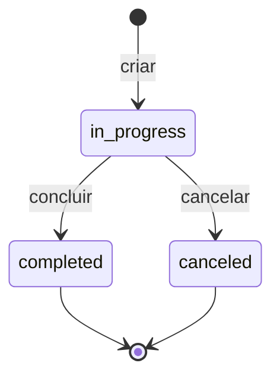

# 14 — Migração Mobile: Regras de Negócio

> **Versão:** 1.0 · **Data:** 08/11/2026 · **Público:** quem implementará o app em React Native (repositório separado)
> **Fonte:** controllers, FormRequests, models, enums, `AmountInWords`, `ReceiptPdfService` e `resources/views/pdf/receipt.blade.php` (comportamento real do código)
> **Relacionado:** `13-migracao-modelo-dados.md`, `15-migracao-contrato-backup.md`, `16-migracao-telas-navegacao.md`

Esta é a especificação das regras que, na web, vivem no PHP e que o app precisa reimplementar no aparelho em TypeScript. Cada seção indica o arquivo de origem. Onde o app diverge da web por decisão (titular único, sem verificação pública), está explícito.

---

## 1. Convenções gerais

| Tema | Regra |
| :--- | :--- |
| Dinheiro | Sempre **centavos inteiros**. Conversão de entrada: `cents = round(valor * 100)` (arredondamento aritmético para inteiro) |
| Entrada de valor monetário | Normalizar o texto antes de validar (ver 2) |
| Moeda e formato | BRL. Exibição: `R$ ` + milhar com ponto + decimal com vírgula (ex.: `R$ 1.542,30`) |
| Idioma | Interface e mensagens de validação em pt-BR |
| Exclusão | Soft delete em clientes, atendimentos e lançamentos (ver `13`, seção 7) |
| Paginação | Clientes, atendimentos, recibos: 15 por página. Lançamentos: 20 por página. No app: rolagem infinita com o mesmo tamanho de página |

---

## 2. Normalização de valores monetários digitados

Origem: `prepareForValidation` de `TransactionRequest` e `AppointmentRequest`.

Algoritmo sobre o texto digitado:

1. Remover todos os espaços.
2. Se contém `,` e **não** contém `.`: trocar `,` por `.` (ex.: `250,50` -> `250.50`).
3. Se contém `.` **e** `,`: remover todos os `.` e trocar `,` por `.` (ex.: `1.250,50` -> `1250.50`).
4. Demais casos permanecem como estão (ex.: `250.50`, `250`).
5. Validar como número e converter para centavos.

> [!NOTE]
> Na web a normalização só roda quando o valor chega como string. No app, usar um campo monetário com máscara que já produza centavos, mantendo este algoritmo apenas como camada de segurança para entrada colada.

---

## 3. Clientes

Origem: `ClientController`, `ClientRequest`, `Client`.

### 3.1 Validação

| Campo | Regra | Mensagem |
| :--- | :--- | :--- |
| name | obrigatório, texto, máx. 160 | O nome do cliente é obrigatório. |
| phone_e164 | opcional, máx. 20, regex `^\+?[0-9]{10,15}$` | Formato de telefone inválido (ex: 81999998888 ou +5581999998888). |
| document_type | opcional, `cpf` ou `cnpj` | |
| document_number | opcional, máx. 20 | |
| email | opcional, e-mail válido, máx. 160 | Informe um e-mail válido. |
| notes | opcional, máx. 1000 | |

### 3.2 Comportamento

| Regra | Detalhe |
| :--- | :--- |
| Cadastro rápido | Somente o nome é obrigatório |
| `search_name` | Recalculado a cada gravação: minúsculas, sem acentos |
| Busca | Termo em minúsculas comparado por `LIKE %termo%` em `search_name`; **ou** `LIKE %termo%` em `document_number`; **ou** `LIKE %termo%` em `phone_e164` (os dois últimos usam o termo original) |
| Ordenação | Por `name` crescente |
| UUID | Gerado na criação se ausente |
| Exclusão | Soft delete. Mensagem: "Cliente arquivado com sucesso!" |
| Ações no detalhe | Editar, excluir, atalho de WhatsApp (se houver telefone), novo atendimento pré-selecionando o cliente |

---

## 4. Atendimentos

Origem: `AppointmentController`, `AppointmentRequest`, `AppointmentStatus`, `Appointment`.

### 4.1 Validação

| Campo | Regra | Mensagem |
| :--- | :--- | :--- |
| client_id | obrigatório, cliente existente | O cliente é obrigatório. / O cliente selecionado não foi encontrado. |
| service_description | obrigatório, máx. 2000 | Informe a descrição do serviço / atendimento. |
| service_at | obrigatório, data/hora válida | Informe a data e horário do atendimento. |
| technical_notes | opcional, máx. 2000 | |
| expected_amount | opcional, numérico, mínimo 0 | O valor previsto deve ser numérico. |

Na criação e na edição, `expected_amount` (valor monetário) é convertido para `expected_amount_cents`. **Na edição, se o valor não for informado, `expected_amount_cents` passa a nulo.**

### 4.2 Máquina de estados (RN-04)

| De | Para | Permitido |
| :--- | :--- | :--- |
| in_progress | completed | Sim |
| in_progress | canceled | Sim |
| completed | qualquer outro | Não (estado final) |
| canceled | qualquer outro | Não (estado final) |
| mesmo estado | mesmo estado | Sim (sem efeito) |

Transição inválida: erro de validação no campo `status` com a mensagem `Não é possível alterar de {rótulo atual} para {rótulo novo}.` Status desconhecido: `Status inválido.`

### 4.3 Efeitos da troca de status

| Novo status | Efeito |
| :--- | :--- |
| completed | `completed_at = agora` |
| canceled | `canceled_at = agora`; `cancel_reason = motivo informado` (opcional, máx. 500) |

### 4.4 Comportamento de tela

| Regra | Detalhe |
| :--- | :--- |
| Estado inicial | `in_progress` |
| Edição | O botão de editar só aparece quando o atendimento está `in_progress` (regra de interface; o código do servidor não a impõe, o app deve impô-la também na camada de serviço) |
| Listagem | Ordenada por `service_at` decrescente; filtros por `status` e por busca |
| Busca | `LIKE %termo%` em `service_description`, **ou** no `name` do cliente |
| Cliente excluído | O nome continua visível (relação carrega registros excluídos) |
| Ligação com caixa | Atendimento concluído pode gerar lançamento de receita (ver 5.3) |

---

## 5. Lançamentos de caixa

Origem: `TransactionController`, `TransactionRequest`, `Transaction`.

### 5.1 Validação

| Campo | Regra | Mensagem |
| :--- | :--- | :--- |
| type | obrigatório, `income` ou `expense` | Informe o tipo do lançamento (receita ou despesa). |
| amount | obrigatório, numérico, mínimo 0,01 | O valor do lançamento é obrigatório. / O valor deve ser maior que zero. |
| occurred_on | obrigatório, data válida | A data do lançamento é obrigatória. |
| description | obrigatório, máx. 255 | |
| category_id | opcional, categoria existente | |
| payment_method | obrigatório: `pix`, `cash`, `card`, `other` | |
| client_id | opcional, cliente existente | |
| appointment_id | opcional, atendimento existente | |
| notes | opcional, máx. 1000 | |

### 5.2 Comportamento

| Regra | Detalhe |
| :--- | :--- |
| Herança de cliente | Se há `appointment_id` e **não** há `client_id`, o lançamento herda o `client_id` do atendimento |
| Listagem | Filtra por **mês** (`YYYY-MM`, padrão: mês atual) e, opcionalmente, por `type`. Ordenação: `occurred_on` decrescente, depois `id` decrescente |
| Resumo do mês | `income_cents` = soma das receitas do mês; `expense_cents` = soma das despesas do mês; `net_cents` = receitas - despesas. **Os totais do mês ignoram o filtro de tipo** |
| Categorias no formulário | Listar as categorias do tipo selecionado, por nome crescente |
| Exclusão | Soft delete. Mensagem: "Lançamento removido com sucesso!" |
| Ação a partir da lista | Em receitas, ação "Emitir recibo" |

### 5.3 Pré-preenchimento a partir de um atendimento

Ao abrir "novo lançamento" com `appointment_id`:

| Campo | Valor |
| :--- | :--- |
| client_id | `client_id` do atendimento |
| description | `Recebimento: {service_description}` |
| amount | `expected_amount_cents / 100` com 2 casas decimais, se existir |
| type | `income` (padrão) |

---

## 6. Recibos

Origem: `ReceiptController`, `IssueReceiptRequest`, `CancelReceiptRequest`, `Receipt`.

### 6.1 Pré-condições de emissão

| Condição | Resultado se violada |
| :--- | :--- |
| O lançamento deve ser do tipo `income` | Erro: "Recibos só podem ser emitidos para lançamentos de entrada / receita." |
| Não pode existir recibo ativo (`status = 'issued'`) para o mesmo lançamento | Abrir o recibo existente com aviso: "Já existe um recibo ativo para este lançamento." |
| Recibo cancelado **não** bloqueia nova emissão para o mesmo lançamento | (somente `issued` conta como ativo) |

### 6.2 Dados informados na emissão

| Campo | Regra | Mensagem |
| :--- | :--- | :--- |
| payer_name | obrigatório, máx. 150 | O nome do cliente/pagador é obrigatório. |
| payer_document | opcional, máx. 20 | |
| description | obrigatório, máx. 500 | A descrição do serviço/venda é obrigatória. |
| payment_method | obrigatório: `pix`, `cash`, `card`, `other` | A forma de pagamento é obrigatória. |

Sugestão de pré-preenchimento (a confirmar com a tela web `Receipts/Create`): pagador = nome do cliente do lançamento; documento = documento do cliente; descrição = descrição do lançamento; forma = forma do lançamento.

### 6.3 Algoritmo de emissão (dentro de uma única transação)

1. `ano = ano corrente`.
2. `ultimo = MAX(number) dos recibos com year = ano` (0 se nenhum).
3. `numero = ultimo + 1`. Reinicia em 1 a cada novo ano.
4. Montar o `issuer_snapshot` (formato em `13`, seção 3).
5. Inserir o recibo com: `transaction_id`, `client_id` (do lançamento), `code` (UUID novo), `year`, `number`, `status = issued`, `issued_at = agora`, `amount_cents` (**copiado do lançamento**), `payment_method`, `description`, `payer_name`, `payer_document`, `issuer_snapshot`.
6. Mensagem de sucesso: `Recibo Nº {numero formatado} emitido com sucesso!`

> [!NOTE]
> No app há um único escritor, então o `lockForUpdate` da web não é necessário. A transação continua obrigatória para que numeração e inserção sejam atômicas.

### 6.4 Formatos

| Item | Formato | Exemplo |
| :--- | :--- | :--- |
| Número formatado | `NNNN/AAAA` (`%04d/%04d`, número com 4 dígitos e ano) | `0001/2026` |
| Valor formatado | `R$ ` + milhar `.` + decimal `,` | `R$ 250,00` |
| Nome do arquivo PDF | `recibo-` + número formatado com `/` trocado por `-` + `.pdf` | `recibo-0001-2026.pdf` |

### 6.5 Cancelamento

| Regra | Detalhe |
| :--- | :--- |
| Motivo | Obrigatório, máx. 500. Mensagem: "Informe o motivo do cancelamento do recibo." |
| Efeito | `status = canceled`, `canceled_at = agora`, `cancel_reason = motivo` |
| Já cancelado | Erro: "Este recibo já está cancelado." |
| Reversão | Não existe. Recibo cancelado não volta a `issued` |
| Numeração | O número de um recibo cancelado **não é reaproveitado** |

### 6.6 Listagem

Ordenada por `issued_at` decrescente. Filtros: `status` e busca textual por `LIKE %termo%` em `payer_name`, `number` ou `description`.

### 6.7 Ações sobre o recibo no app

| Ação na web | Ação no app |
| :--- | :--- |
| Ver PDF / baixar PDF | Gerar PDF local, abrir e salvar |
| Enviar por e-mail (SMTP) | **Compartilhar o PDF** pelo sistema (WhatsApp, e-mail, etc.) |
| Link público `/r/{code}` e QR de verificação | **Removido** (decisão tomada) |
| Cancelar | Igual |

---

## 7. PDF do recibo (especificação de conteúdo)

Origem: `resources/views/pdf/receipt.blade.php`. Papel A4 retrato, margens 20 mm (vertical) e 15 mm (horizontal), fonte sans-serif, cor primária `#4f46e5`, texto `#1f2937`.

Blocos, na ordem:

1. **Se cancelado:** marca d'água `CANCELADO` e faixa de aviso com data/hora de cancelamento (`dd/MM/yyyy HH:mm`) e motivo.
2. **Cabeçalho (3 colunas):**
   - Logo (se existir; máx. 80x80 px, cantos arredondados).
   - Nome da loja em maiúsculas (`store_name`, senão `display_name`, senão "Comprovante Comercial"); abaixo: `{TIPO}: {documento}` seguido de ` • Tel: {telefone}` quando houver; e, em nova linha, `full_address` quando houver.
   - Selo: `RECIBO Nº {número formatado}` e `Emissão: dd/MM/yyyy HH:mm`.
3. **Caixa de valor:** rótulo "Valor Recebido" e valor formatado.
4. **Valor por extenso:** título "Valor por Extenso" e `({texto por extenso})`.
5. **Dados do pagador:** `Nome` e, se houver, `CPF / CNPJ`.
6. **Referente a / Descrição:** texto da descrição.
7. **Informações de pagamento:** `Forma de Pagamento` em maiúsculas (usa o **valor interno** em maiúsculas, ex.: `PIX`, `CASH`, `CARD`, `OTHER`; recomenda-se usar o rótulo pt-BR no app, o que é uma melhoria consciente em relação à web).
8. **Rodapé:** "Este documento comprova o recebimento do valor especificado acima para os devidos fins de direito." e "Chave de Autenticidade Digital: {code}".
   - **Removido no app:** a linha "Consulte a autenticidade online em: {URL}", pois não há verificação pública.

Logo no PDF: carregada a partir de `issuer_snapshot.logo_path` e embutida como imagem base64.

> [!WARNING]
> Possível defeito na web, a confirmar: a logo é gravada pelo `BusinessProfileController` no disco `local` (`private/logos`), mas o `ReceiptPdfService` a procura no disco `public`. Se confirmado, a logo nunca aparece no PDF da web. No app não há essa separação de discos; o requisito correto é: **a logo aparece no PDF**.

Geração do PDF no React Native: gerar HTML a partir deste layout e convertê-lo em PDF no aparelho (ver `12`).

---

## 8. Valor por extenso

Origem: `app/Support/AmountInWords.php` (reimplementar em TypeScript produzindo **exatamente a mesma saída**).

### 8.1 Algoritmo

Entrada: inteiro `cents`.

1. `cents == 0` -> `zero reais`.
2. `reais = cents div 100`, `centavos = cents mod 100`.
3. Se `reais > 0`: texto de `reais` + ` real` (se `reais == 1`) ou ` reais`.
4. Se `centavos > 0`: texto de `centavos` + ` centavo` (se `centavos == 1`) ou ` centavos`.
5. Unir as partes presentes com ` e `.

**Milhares (para `reais`):**

- `reais == 1000` -> `mil`.
- Dividir em milhões, milhares e resto (`< 1000`).
- Milhões: `{até999} milhão` (se 1) ou `{até999} milhões`.
- Milhares: `mil` (se 1) ou `{até999} mil`.
- Resto: `{até999}`.
- Unir as partes presentes com ` e ` (**sempre** `e`, inclusive entre milhar e centenas).

**Até 999:**

- `100` -> `cem`.
- `< 20`: tabela de unidades (0 vazio; um, dois, três, quatro, cinco, seis, sete, oito, nove, dez, onze, doze, treze, quatorze, quinze, dezesseis, dezessete, dezoito, dezenove).
- `< 100`: dezena (vinte, trinta, quarenta, cinquenta, sessenta, setenta, oitenta, noventa) e, se houver unidade, ` e {unidade}`.
- `>= 100`: centena (cento, duzentos, trezentos, quatrocentos, quinhentos, seiscentos, setecentos, oitocentos, novecentos); se há resto, ` e {até99 do resto}`; sem resto, apenas a centena.

### 8.2 Casos de referência (da suíte `AmountInWordsTest`)

| Entrada (centavos) | Saída esperada |
| ---: | :--- |
| 0 | `zero reais` |
| 1 | `um centavo` |
| 10 | `dez centavos` |
| 100 | `um real` |
| 101 | `um real e um centavo` |
| 200 | `dois reais` |
| 10000 | `cem reais` |
| 25050 | `duzentos e cinquenta reais e cinquenta centavos` |
| 100000 | `mil reais` |
| 154230 | `mil e quinhentos e quarenta e dois reais e trinta centavos` |

> [!NOTE]
> O último caso mostra que a web usa sempre ` e ` entre milhar e centenas. Gramaticalmente, "mil quinhentos e quarenta e dois" é mais usual. Para **paridade**, o app deve reproduzir a saída da web; se a correção for desejada, ela deve ser feita na web e no app ao mesmo tempo, atualizando estes casos de referência.

Limitação conhecida do algoritmo: a faixa do milhão é tratada, mas valores acima de `999.999.999` não são cobertos.

---

## 9. Início (dashboard)

Origem: `DashboardController`. Janela: do primeiro ao último dia do **mês corrente** (`occurred_on` entre os dois).

| Métrica | Definição |
| :--- | :--- |
| total_clients | Quantidade de clientes ativos |
| store_name | `store_name`, senão `display_name`, senão `"Minha Loja"` |
| activity_description | Campo do perfil da loja |
| month_income_cents | Soma de `amount_cents` das receitas do mês |
| month_expense_cents | Soma das despesas do mês |
| month_balance_cents | receitas - despesas |
| in_progress_appointments | Quantidade de atendimentos ativos com `status = in_progress` (todos, sem filtro de período) |
| recent_clients | Os 5 clientes mais recentes (`created_at` decrescente): id, nome, telefone |
| recent_transactions | Os 5 lançamentos mais recentes (`occurred_on` decrescente), com categoria e cliente |

**Checklist de onboarding:**

| Item | Concluído quando |
| :--- | :--- |
| store_profile_completed | `store_name` preenchido (não vazio) |
| first_client_added | Existe ao menos 1 cliente |
| first_transaction_recorded | Existe ao menos 1 lançamento |

---

## 10. Relatórios

Origem: `ReportController`. Parâmetros: abas `faturamento` (padrão), `atendimentos`, `clientes`, `anual`; período `start_date`/`end_date` (padrão: mês corrente); `year` (padrão: ano corrente). Todas as consultas usam apenas registros ativos (`deleted_at IS NULL`) e valores em centavos.

### 10.1 Faturamento

| Saída | Definição |
| :--- | :--- |
| income_cents | Soma das receitas com `occurred_on` no período |
| expense_cents | Soma das despesas no período |
| net_cents | income - expense |
| by_category | Agrupado por `(type, nome da categoria)`; sem categoria vira `"Sem Categoria"`; traz `total_cents` (soma) e `count`; ordenado por `total_cents` decrescente. Considera receitas **e** despesas |
| by_payment_method | Somente **receitas** do período, agrupado por `payment_method`: `total_cents` e `count` |

### 10.2 Atendimentos

Filtra por **dia** de `service_at` entre as datas (inclusive).

| Saída | Definição |
| :--- | :--- |
| total_appointments | Total no período |
| in_progress_count / completed_count / canceled_count | Contagem por status |
| expected_total_cents | Soma de `expected_amount_cents` de **todos** os atendimentos do período (inclui cancelados; nulos contam como 0) |

### 10.3 Clientes (ranking)

Top 10 clientes por faturamento de **receitas** no período, via junção `clients` x `transactions`.

| Saída | Definição |
| :--- | :--- |
| id, name, phone_e164 | Dados do cliente |
| total_revenue_cents | Soma das receitas do cliente no período |
| transactions_count | Quantidade de receitas |

Ordenação: `total_revenue_cents` decrescente; limite 10. Apenas clientes com ao menos uma receita no período aparecem.

> [!WARNING]
> Possível defeito na web, a confirmar: a consulta une `clients` e `transactions` por SQL direto. O escopo de exclusão lógica é aplicado ao model `Client`, mas **não** a `transactions.deleted_at`, então receitas excluídas podem entrar no ranking. No app, o comportamento correto é **filtrar `deleted_at IS NULL` em ambas as tabelas**. Registrar essa decisão nos testes de referência e corrigir a web.

### 10.4 Anual

Para cada mês `1..12` do ano: `income_cents`, `expense_cents`, `net_cents` (receitas, despesas e saldo do mês), com o nome abreviado do mês em pt-BR (jan, fev, mar, abr, mai, jun, jul, ago, set, out, nov, dez). Totais do ano: soma de receitas, de despesas e do saldo.

---

## 11. Minha Loja (perfil do emitente)

Origem: `BusinessProfileController`, `BusinessProfileUpdateRequest`.

| Campo | Regra | Mensagem |
| :--- | :--- | :--- |
| display_name | obrigatório, máx. 160 | O nome de exibição é obrigatório. |
| store_name | opcional, máx. 160 | |
| activity_description | opcional, máx. 1000 | |
| document_type | opcional, `cpf` ou `cnpj` | |
| document_number | opcional, máx. 20 | |
| phone | opcional, máx. 20 | |
| postal_code | opcional, máx. 10 | |
| street | opcional, máx. 160 | |
| number | opcional, máx. 20 | |
| complement | opcional, máx. 60 | |
| neighborhood | opcional, máx. 80 | |
| city | opcional, máx. 80 | |
| state | opcional, exatamente 2 caracteres | O estado (UF) deve ter 2 letras (ex: PE, SP). |
| logo | opcional, imagem PNG/JPG/JPEG/WEBP, máx. 2 MB | O logotipo deve ser um arquivo de imagem válido. / ... PNG, JPG, JPEG ou WEBP. / ... não pode ultrapassar 2MB de tamanho. |

**Logo:**

- Ao enviar nova logo, a anterior é apagada do armazenamento.
- Pré-processamento (web: `Utils/imageCompressor.ts`): rejeitar arquivos que não sejam imagem; rejeitar originais maiores que 20 MB; redimensionar mantendo proporção para no máximo **800x800 px**; qualidade 0,85; manter PNG se a origem for PNG, senão JPEG; rejeitar se o resultado ainda passar de **2 MB**.
- No app: equivalente com a biblioteca de manipulação de imagens do React Native.

**Primeiro uso:** criar o perfil com `display_name = nome do titular` e semear as categorias padrão (equivalente ao `RegisteredUserController`).

---

## 12. Titular, termos e "apagar tudo"

| Tema | Regra |
| :--- | :--- |
| Onboarding | Nome do titular (obrigatório, máx. 255) e **aceite dos termos** (obrigatório). Mensagem de erro: "É necessário aceitar os termos de uso para prosseguir." Grava `terms_accepted_at` |
| Não há | E-mail, senha, verificação de e-mail, recuperação de senha |
| Bloqueio do app | PIN e/ou biometria, opcional. Esquecer o PIN não tem recuperação; a saída é reinstalar e restaurar um backup. Avisar isso na criação do PIN |
| Apagar todos os dados | Equivalente a "excluir conta" da web, **com double check** (digitar a palavra de confirmação). Ordem de exclusão física em `13`, seção 7. Após apagar, o app volta ao onboarding |

---

## 13. Erros e mensagens

Mensagens de sucesso da web que devem ser mantidas (texto idêntico):

| Evento | Mensagem |
| :--- | :--- |
| Cliente criado | Cliente cadastrado com sucesso! |
| Cliente atualizado | Cliente atualizado com sucesso! |
| Cliente excluído | Cliente arquivado com sucesso! |
| Atendimento criado | Atendimento agendado com sucesso! |
| Atendimento atualizado | Atendimento atualizado com sucesso! |
| Status alterado | Status do atendimento atualizado! |
| Atendimento excluído | Atendimento removido com sucesso! |
| Lançamento criado | Lançamento registrado com sucesso! |
| Lançamento excluído | Lançamento removido com sucesso! |
| Recibo emitido | Recibo Nº {número} emitido com sucesso! |
| Recibo cancelado | Recibo cancelado com sucesso. |

---

## 14. Casos de teste de referência a portar

Fonte: suíte Pest em `tests/`. Devem ser reescritos como testes do app (Jest/Vitest equivalente) e passar com o mesmo resultado:

| Arquivo da web | Cobertura a replicar |
| :--- | :--- |
| `tests/Unit/AmountInWordsTest.php` | Valor por extenso (seção 8.2) |
| `tests/Feature/AppointmentTest.php` | Criação, transições de status e bloqueio de transição inválida |
| `tests/Feature/TransactionTest.php` | Lançamento, herança de cliente, soft delete |
| `tests/Feature/ReceiptTest.php` | Numeração por ano, bloqueio de duplicidade, bloqueio para despesa, cancelamento |
| `tests/Feature/ReportTest.php` | Cálculos dos relatórios |
| `tests/Feature/DashboardTest.php` | Métricas e checklist |
| `tests/Feature/UserBackupTest.php` | Export, merge, replace com double check |
| `tests/Feature/EndToEndJourneyTest.php` | Jornada completa da persona |

Os testes de isolamento entre usuários (multi-tenant) **não se aplicam** ao app de titular único.
