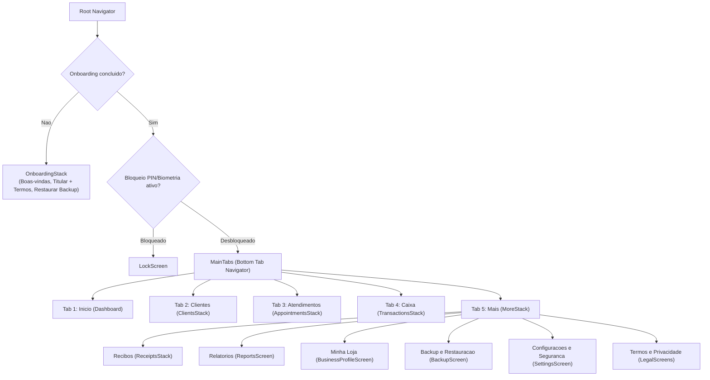

# 16 — Migração Mobile: Telas, Navegação e Design System (React Native)

> **Versão:** 1.0 · **Data:** 08/11/2026 · **Público:** quem implementará o app em React Native (repositório separado)
> **Fonte:** `resources/js/Pages/**`, `resources/js/Layouts/**`, `docs/05-frontend-telas.md`, `docs/identidade_visual_do_gest_gil.md`
> **Relacionado:** `12-plano-app-android.md`, `13-migracao-modelo-dados.md`, `14-migracao-regras-negocio.md`, `15-migracao-contrato-backup.md`

Este documento mapeia cada página da versão web para sua tela correspondente em **React Native**, detalhando a arquitetura de navegação, adaptação de tabelas para listas móveis (`FlatList`), fluxos de modais, deep links e tokens de design.

---

## 1. Arquitetura de Navegação (React Navigation / Expo Router)

Na web, a navegação usa uma barra superior com 7 itens e um menu dropdown do usuário. No Android, para cumprir o requisito **RNF-01** (ações frequentes ao alcance do polegar e fluxos principais em até 3 toques), adota-se **Bottom Tab Navigator** combinado com **Native Stack Navigator**.

### 1.1 Mapa de Rotas Mobile vs Web

| Rota / Página Web (`resources/js/Pages`) | Rota Mobile (React Navigation / Expo Router) | Tipo de Tela |
| :--- | :--- | :--- |
| `Welcome.vue` + `Auth/Register.vue` | `Onboarding/Welcome` -> `Onboarding/Setup` | Stack inicial (exibida apenas antes de existir registro em `owner`) |
| `Auth/Login.vue` | `Auth/LockScreen` | Modal/Tela de bloqueio por PIN ou Biometria |
| `Auth/ForgotPassword`, `ResetPassword`, `VerifyEmail` | *(Descartadas)* | Sem conta em servidor |
| `Dashboard.vue` | `Tabs/Dashboard` | Aba 1 (Início) |
| `Clients/Index.vue` | `Tabs/Clients/Index` | Aba 2 (Lista) |
| `Clients/Create.vue` | `Tabs/Clients/Create` | Stack / Modal |
| `Clients/Show.vue` | `Tabs/Clients/Show` (`{ uuid }`) | Stack |
| `Clients/Edit.vue` | `Tabs/Clients/Edit` (`{ uuid }`) | Stack |
| `Appointments/Index.vue` | `Tabs/Appointments/Index` | Aba 3 (Lista) |
| `Appointments/Create.vue` | `Tabs/Appointments/Create` (`{ clientId? }`) | Stack |
| `Appointments/Show.vue` | `Tabs/Appointments/Show` (`{ uuid }`) | Stack |
| `Appointments/Edit.vue` | `Tabs/Appointments/Edit` (`{ uuid }`) | Stack |
| `Transactions/Index.vue` | `Tabs/Transactions/Index` | Aba 4 (Lista) |
| `Transactions/Create.vue` | `Tabs/Transactions/Create` (`{ type?, appointmentId? }`) | Stack |
| `Receipts/Index.vue` | `More/Receipts/Index` | Stack dentro de "Mais" |
| `Receipts/Create.vue` | `More/Receipts/Create` (`{ transactionId }`) | Stack |
| `Receipts/Show.vue` | `More/Receipts/Show` (`{ code }`) | Stack |
| `Reports/Index.vue` | `More/Reports` | Stack dentro de "Mais" |
| `BusinessProfile/Edit.vue` | `More/BusinessProfile` | Stack dentro de "Mais" |
| `Backup/Index.vue` | `More/Backup` | Stack dentro de "Mais" |
| `Profile/Edit.vue` + Partials | `More/Settings` | Stack dentro de "Mais" |
| `Legal/Terms.vue` e `Legal/Privacy.vue` | `Legal/Terms` e `Legal/Privacy` | Acessíveis no Onboarding e em "Mais" |
| `Public/ReceiptVerification.vue` | *(Descartada)* | Decisão de produto: sem verificação pública nesta versão |

---

## 2. Design System e Tokens Visuais

Extraído de `docs/identidade_visual_do_gest_gil.md` e das classes Tailwind aplicadas nas páginas Vue.

### 2.1 Paleta de Cores

| Token Semântico | Hexadecimal | Equivalente Tailwind | Uso no App |
| :--- | :--- | :--- | :--- |
| `primary` (Azul Confiança) | `#1E40AF` / `#4F46E5` | `blue-800` / `indigo-600` | Botões primários, cabeçalhos, aba ativa, links |
| `primaryLight` | `#EEF2FF` / `#DBEAFE` | `indigo-50` / `blue-100` | Fundos de destaque leve, badges informativos |
| `accent` (Verde Ágil) | `#10B981` | `emerald-500` | FAB de lançamento rápido, botões de WhatsApp |
| `income` / `completed` (Sucesso) | `#059669` / `#16A34A` | `emerald-600` / `green-600` | Valores de entrada (`+`), status `Concluído`, recibo emitido |
| `incomeBg` | `#ECFDF5` / `#DCFCE7` | `emerald-50` / `green-100` | Fundo de card/badge de receita e atendimento concluído |
| `expense` / `canceled` (Perigo) | `#E11D48` / `#DC2626` | `rose-600` / `red-600` | Valores de saída (`-`), status `Cancelado`, botões destrutivos |
| `expenseBg` | `#FFF1F2` / `#FEE2E2` | `rose-50` / `red-100` | Fundo de card/badge de despesa e atendimento cancelado |
| `inProgress` (Atenção) | `#D97706` / `#92400E` | `amber-600` / `amber-800` | Status `Em Andamento` |
| `inProgressBg` | `#FEF3C7` | `amber-100` | Badge de atendimento `Em Andamento` |
| `background` | `#F9FAFB` / `#F3F4F6` | `gray-50` / `gray-100` | Fundo geral das telas |
| `surface` | `#FFFFFF` | `white` | Cards, itens de lista e modais |
| `textPrimary` | `#111827` | `gray-900` | Títulos, nomes e valores |
| `textSecondary` | `#6B7280` | `gray-500` | Subtítulos, datas e rótulos auxiliares |
| `border` | `#E5E7EB` | `gray-200` | Divisores de lista e bordas de campos |

### 2.2 Tipografia e Ergonomia Mobile

- **Fonte:** `Inter` ou `Plus Jakarta Sans` (pesos 400, 500, 600, 700).
- **Números tabulares:** ativar `fontVariant: ['tabular-nums']` em todos os componentes que exibem valores em reais (`R$`), datas e números de recibos.
- **Alvos de toque:** altura mínima de `48dp` em todos os botões, linhas de lista clicáveis e seletores.
- **Adaptação de Tabelas Web para Mobile:** Na web, as listagens (`Clients/Index`, `Appointments/Index`, `Transactions/Index`, `Receipts/Index`) usam `<table>`. No React Native, **não usar tabelas horizontais com scroll**; cada linha deve ser renderizada como um **Card compacto em `FlatList`** com paginação incremental (`onEndReached`).

---

## 3. Especificação Detalhada por Tela

### 3.1 Onboarding Inicial e Tela de Bloqueio (`Onboarding/*` e `LockScreen`)

Substitui `Welcome.vue`, `Auth/Register.vue` e `Auth/Login.vue`.

- **Estado Inicial:** Ao abrir o app, se não houver linha na tabela `owner`, exibir `Onboarding/Welcome` com a logo (`assets/gestagil-logo-removegb.png`) e dois botões:
  1. **"Começar Agora"**: leva ao formulário `Onboarding/Setup`.
  2. **"Já tenho um arquivo de backup"**: abre o seletor de arquivo `.json`, executa a restauração e cria o registro em `owner` com o nome vindo do backup.
- **Formulário `Onboarding/Setup`:**
  - Campo `name` (Nome completo ou como prefere ser chamado, obrigatório).
  - Campo opcional `store_name` (Nome da Loja / Oficina — já adianta o passo 1 do checklist se preenchido).
  - Checkbox obrigatório: *"Li e concordo com os Termos de Uso e Política de Privacidade"* (links abrem as telas `Legal/Terms` e `Legal/Privacy`).
  - Seção opcional: **"Proteger aplicativo com PIN / Biometria"** (permite cadastrar um PIN de 4 a 6 dígitos com aviso claro: *"Como seus dados ficam 100% no aparelho e sem servidor, caso esqueça o PIN será necessário reinstalar o app e restaurar um backup"*).
  - Ao confirmar: grava `owner`, cria `business_profiles` inicial, roda a semente das 9 categorias padrão (`DefaultCategoriesSeeder`) e redireciona para `Tabs/Dashboard`.

---

### 3.2 Início (`Tabs/Dashboard`)

Espelha `Dashboard.vue`.

- **Cabeçalho:** Saudação com o nome da loja (`metrics.store_name`), descrição da atividade (`activity_description`) e botão rápido **"Editar Loja"**.
- **Bloco condicional — Checklist de Primeiros Passos:**
  - Exibido apenas enquanto algum dos 3 itens for `false`:
    1. `store_profile_completed` ("Configurar nome da loja") -> navega para `More/BusinessProfile`.
    2. `first_client_added` ("Cadastrar 1º cliente") -> navega para `Tabs/Clients/Create`.
    3. `first_transaction_recorded` ("Registrar 1º lançamento") -> navega para `Tabs/Transactions/Create`.
  - Barra de progresso (`0%`, `33%`, `67%`, `100%`).
- **Alerta de Backup (Adição Mobile):**
  - Se o último backup exportado tiver mais de 7 dias (ou nunca tiver sido feito) e houver dados cadastrados, exibir um banner discreto com botão para `More/Backup`.
- **Cards de Resumo Financeiro do Mês (Grid 2x2):**
  1. **Entradas (Mês):** `month_income_cents` em verde (`#059669`).
  2. **Saídas (Mês):** `month_expense_cents` em vermelho (`#E11D48`).
  3. **Saldo do Mês:** `month_balance_cents` (azul se `>= 0`, vermelho se `< 0`).
  4. **Em Andamento:** `in_progress_appointments` atendimentos abertos (toque leva para `Tabs/Appointments/Index` filtrado por `in_progress`).
- **Grade de Atalhos do Comerciante (2x2):**
  - **Nova Venda / Entrada** -> `Tabs/Transactions/Create` (`{ type: 'income' }`).
  - **Nova Despesa** -> `Tabs/Transactions/Create` (`{ type: 'expense' }`).
  - **Novo Atendimento** -> `Tabs/Appointments/Create`.
  - **Fluxo de Caixa** -> `Tabs/Transactions/Index`.
- **Listas Recentes:**
  - **Últimas Movimentações** (até 5 itens): descrição, categoria, cliente, data e valor colorido (`+` ou `-`).
  - **Clientes Recentes** (até 5 itens): nome, telefone e botão **"WhatsApp"** (abre `https://wa.me/{digitos}` via `Linking.openURL`).

---

### 3.3 Clientes (`Tabs/Clients/*`)

Espelha `Clients/Index.vue`, `Create.vue`, `Edit.vue` e `Show.vue`.

- **`Clients/Index`:**
  - Barra de busca no topo com debounce de `300ms` ("Buscar por nome, documento ou telefone...").
  - Contador de total de clientes.
  - `FlatList` de cards: cada card exibe `name`, `phone_e164` (ou "Sem telefone"), `document_number` e seta para abrir o detalhe.
  - Botão flutuante (FAB) ou botão no cabeçalho: **"+ Novo Cliente"**.
- **`Clients/Create` e `Clients/Edit`:**
  - Campos:
    - `name` (obrigatório, `autoFocus` na criação).
    - `phone_e164` (teclado numérico `phone-pad`).
    - Seletor `document_type` (`CPF` | `CNPJ`) + `document_number` (teclado numérico).
    - `email` (`keyboardType="email-address"`, `autoCapitalize="none"`).
    - `notes` (multiline).
- **`Clients/Show`:**
  - Card de Informações Gerais: Nome, Telefone (clicável para abrir WhatsApp), Documento, E-mail (clicável para `mailto:`), Observações.
  - Botões de ação:
    - **"+ Novo Atendimento"** (abre `Appointments/Create` já com `client_id` selecionado).
    - **"Editar"** -> `Clients/Edit`.
    - **"Excluir"** -> abre modal de confirmação ("Confirmar exclusão de cliente").

---

### 3.4 Atendimentos e Ordens de Serviço (`Tabs/Appointments/*`)

Espelha `Appointments/Index.vue`, `Create.vue`, `Edit.vue` e `Show.vue`.

- **`Appointments/Index`:**
  - Campo de busca com debounce de `300ms` ("Buscar por serviço ou cliente...").
  - Chips horizontais de filtro de status: `Todos`, `Em Andamento`, `Concluído`, `Cancelado`.
  - `FlatList` de cards: cada card mostra data/hora (`dd/MM/yyyy HH:mm`), nome do cliente, descrição resumida (2 linhas), valor previsto (`expected_amount_cents`) e badge colorido de status.
- **`Appointments/Create` e `Appointments/Edit`:**
  - Seletor de cliente (com busca rápida e opção "+ Cadastrar cliente rápido" inline).
  - `service_description` (obrigatório, multiline).
  - `service_at` (DateTimePicker nativo de data e hora).
  - `expected_amount` (input monetário em reais).
  - `technical_notes` (opcional, multiline).
- **`Appointments/Show`:**
  - Cabeçalho com número/identificador e badge de status.
  - Card de Dados do Cliente (com link para `Clients/Show` e atalho para conversar no WhatsApp).
  - Card de Detalhes do Serviço: descrição, valor previsto, notas técnicas (em caixa âmbar) e banner de conclusão (verde, com `completed_at`) ou cancelamento (vermelho, com `canceled_at` e `cancel_reason`).
  - **Barra de Ações (condicional ao status):**
    - Se `status === 'in_progress'`:
      - Botão **"Concluir Atendimento"** (muda status para `completed`).
      - Botão **"Editar"** -> `Appointments/Edit`.
      - Botão **"Cancelar"** -> abre modal exigindo `cancel_reason` ("Informe o motivo do cancelamento").
    - Se `status === 'completed'`:
      - Botão em destaque **"Lançar Recebimento no Caixa"** -> navega para `Transactions/Create` passando `appointment_id` (que pré-preenche cliente, descrição `"Recebimento: {service_description}"` e valor previsto).

---

### 3.5 Fluxo de Caixa (`Tabs/Transactions/*`)

Espelha `Transactions/Index.vue` e `Create.vue`.

- **`Transactions/Index`:**
  - Seletor de mês (`YYYY-MM`, com setas `<` mês anterior e `>` próximo mês) e filtro de tipo (`Todos`, `Entradas`, `Saídas`).
  - **3 Cards de Resumo Mensal:**
    - Total de Entradas (`summary.income_cents`, verde).
    - Total de Saídas (`summary.expense_cents`, vermelho).
    - Resultado Líquido (`summary.net_cents`, azul se positivo, vermelho se negativo).
  - Dois botões de ação rápida no topo ou rodapé: **"- Nova Despesa"** (vermelho) e **"+ Nova Entrada"** (verde).
  - `FlatList` de lançamentos do mês:
    - Cada item exibe: data (`dd/MM/yyyy`), descrição, badge da categoria (com a cor hexadecimal da categoria), nome do cliente (se houver), forma de pagamento (`Pix`, `Dinheiro`, `Cartão`, `Outro`) e valor (`+` ou `-`).
    - Ações no item:
      - Se `type === 'income'`: botão **"Emitir Recibo"** -> navega para `Receipts/Create` com `transaction_id` (se já houver recibo ativo, abre direto `Receipts/Show`).
      - Botão **"Excluir"** -> confirmação nativa (`Alert.alert`) e soft delete.
- **`Transactions/Create`:**
  - Seletor de tipo no topo (`Entrada / Receita` vs `Saída / Despesa`), que filtra automaticamente a lista de categorias exibidas.
  - `amount` (input monetário em destaque).
  - `occurred_on` (seletor de data, padrão: hoje).
  - `description` (obrigatório).
  - `category_id` (lista de categorias do tipo selecionado).
  - `payment_method` (botões segmentados: `Pix`, `Dinheiro`, `Cartão`, `Outro`).
  - `client_id` (opcional).
  - `notes` (opcional).

---

### 3.6 Recibos (`More/Receipts/*`)

Espelha `Receipts/Index.vue`, `Create.vue` e `Show.vue`.

- **`Receipts/Index`:**
  - Busca textual (`payer_name`, `number` ou `description`) e filtro de status (`Todos`, `Emitidos`, `Cancelados`).
  - `FlatList` de recibos: número formatado (`0001/2026`), data de emissão, nome do pagador, valor e badge (`Emitido` em verde ou `Cancelado` em vermelho).
- **`Receipts/Create`:**
  - Exibe resumo do lançamento de origem.
  - Campos pré-preenchidos editáveis:
    - `payer_name` (nome do cliente ou digitado na hora, obrigatório).
    - `payer_document` (CPF/CNPJ do pagador, opcional).
    - `description` (descrição do lançamento, obrigatório).
    - `payment_method` (forma de pagamento do lançamento, obrigatório).
  - Prévia dos dados do emitente que serão congelados no `issuer_snapshot` (com aviso se a loja ainda não tiver CPF/CNPJ configurado).
- **`Receipts/Show`:**
  - Visualização completa do recibo na tela: tarja de `CANCELADO` (se aplicável), cabeçalho da loja (do `issuer_snapshot`), número `NNNN/AAAA`, valor numérico, valor por extenso (`amount_in_words`), dados do pagador, referente a, forma de pagamento e código UUID (`code`).
  - **Ações principais:**
    1. **"Compartilhar PDF (WhatsApp / Outros)"**: gera o arquivo `recibo-NNNN-AAAA.pdf` via `expo-print` e abre a folha nativa de compartilhamento (`expo-sharing`). Substitui tanto o botão de download quanto o envio por e-mail via SMTP da web.
    2. **"Visualizar / Imprimir PDF"**: abre o visualizador/impressão nativo do Android (`Print.printAsync`).
    3. **"Cancelar Recibo"** (visível apenas se `status === 'issued'`): abre modal exigindo `cancel_reason` obrigatório.

---

### 3.7 Relatórios (`More/Reports`)

Espelha `Reports/Index.vue`.

- **Abas Superiores (Segmented Control):**
  1. `Faturamento` (`faturamento`)
  2. `Atendimentos` (`atendimentos`)
  3. `Ranking de Clientes` (`clientes`)
  4. `Desempenho Anual` (`anual`)
- **Filtro de Período:**
  - Nas 3 primeiras abas: seletores `start_date` e `end_date` (padrão: início e fim do mês atual) + atalhos rápidos ("Este mês", "Mês passado", "Últimos 90 dias").
  - Na aba `Anual`: seletor de `year` (ano).
- **Conteúdo por Aba:**
  - **Faturamento:** 3 cards (Receitas, Despesas, Saldo Líquido), lista agrupada por categoria (`by_category`, com barra de proporção e contagem) e lista por forma de pagamento (`by_payment_method`).
  - **Atendimentos:** total no período, contagens por status (`Em Andamento`, `Concluídos`, `Cancelados`) e soma do valor previsto (`expected_total_cents`).
  - **Clientes:** lista Top 10 clientes por receita no período (`name`, `phone_e164`, `transactions_count` e `total_revenue_cents`).
  - **Anual:** gráfico de barras horizontais ou verticais mês a mês (`Jan` a `Dez`) comparando `income_cents` e `expense_cents`, seguido do consolidado anual.

---

### 3.8 Minha Loja (`More/BusinessProfile`)

Espelha `BusinessProfile/Edit.vue`.

- **Seção Logotipo:**
  - Prévia da logo atual (ou placeholder com iniciais da loja).
  - Botões **"Escolher da Galeria"** e **"Tirar Foto"** (`expo-image-picker`).
  - Compressão automática para no máximo `800x800 px`, qualidade `0.85` e limite de `2 MB` (`expo-image-manipulator`), salvando no diretório local do app.
- **Seção Dados Comerciais:**
  - `store_name` (Nome Fantasia), `display_name` (Razão Social / Nome de Exibição, obrigatório), `activity_description`, `document_type` (`CPF` | `CNPJ`), `document_number`, `phone`.
- **Seção Endereço:**
  - `postal_code` (CEP), `street`, `number`, `complement`, `neighborhood`, `city`, `state` (UF de 2 letras).

---

### 3.9 Backup e Restauração (`More/Backup`)

Espelha `Backup/Index.vue`.

- **Visão Geral dos Dados Atuais:** 4 contadores (Clientes, Atendimentos, Lançamentos, Recibos).
- **Card 1 — Exportar Cópia de Segurança:**
  - Botão **"Exportar e Compartilhar Arquivo (.json)"**: gera o JSON no formato do documento `15` e aciona o compartilhamento nativo do Android (permitindo salvar na pasta Downloads, enviar para o Google Drive, WhatsApp ou e-mail).
  - Seção opcional Google Drive (Fase 9 do plano): botão **"Salvar no Google Drive"** usando `appDataFolder`.
- **Card 2 — Restaurar ou Mesclar Dados:**
  - Botão para selecionar arquivo `.json` (`expo-document-picker`).
  - Pré-visualização do arquivo selecionado (data de exportação e contagens de `metadata`).
  - Seletor de modo (Radio):
    1. **Mesclar dados (Recomendado)** (`merge`).
    2. **Sobrescrever tudo** (`replace`).
  - **Modal de Double Check (obrigatório quando `mode === 'replace'`):**
    - Aviso em vermelho alertando que todos os dados atuais serão substituídos e que um snapshot de emergência será salvo antes.
    - Campo de texto exigindo digitar exatamente **`SOBRESCREVER`**.
    - Botão destrutivo **"Confirmar e Sobrescrever Tudo"** desabilitado enquanto o texto não coincidir (`overwriteConfirmationText.trim().toUpperCase() === 'SOBRESCREVER'`).

---

### 3.10 Configurações e Privacidade (`More/Settings`)

Substitui `Profile/Edit.vue` e seus partials (`UpdateProfileInformationForm`, `UpdatePasswordForm`, `DeleteUserForm`).

- **Bloco 1 — Dados do Titular:** alterar `owner.name`.
- **Bloco 2 — Segurança do Aplicativo:** ativar/desativar ou alterar PIN e desbloqueio por biometria (`expo-local-authentication`).
- **Bloco 3 — Zona de Perigo (LGPD — Apagar Todos os Dados):**
  - Equivalente ao `DeleteUserForm.vue` da web.
  - Exige **Double Check** (digitar `APAGAR TUDO` ou informar o PIN atual) antes de executar a exclusão física em cascata (`receipts` -> `transactions` -> `appointments` -> `transaction_categories` -> `clients` -> `business_profiles` -> arquivo de logo -> `owner`) e retornar o app para a tela de Onboarding.

---

## 4. Integrações com o Sistema Android (Deep Links e Permissões)

| Recurso | Como funciona na Web | Como implementar no React Native |
| :--- | :--- | :--- |
| Conversar no WhatsApp | `<a href="https://wa.me/55...">` | `Linking.openURL('https://wa.me/' + phone.replace(/\D/g, ''))` |
| Enviar e-mail ao cliente | `<a href="mailto:...">` | `Linking.openURL('mailto:' + email)` |
| Baixar / Enviar Recibo PDF | Download pelo navegador ou SMTP | `expo-print` (`printToFileAsync`) + `expo-sharing` (`shareAsync`) |
| Escolher logo da loja | `<input type="file" accept="image/*">` | `expo-image-picker` + `expo-image-manipulator` |
| Exportar backup `.json` | Stream download HTTP | `expo-file-system` + `expo-sharing` |
| Importar backup `.json` | Upload via `<input type="file">` | `expo-document-picker` + leitura via `expo-file-system` |

Permissões mínimas no `AndroidManifest.xml`:
- **Sem permissão de internet obrigatória para o MVP local** (apenas se habilitar o backup direto com a API do Google Drive na Fase 9).
- Uso do Photo Picker / Document Picker do sistema Android (não exige `READ_EXTERNAL_STORAGE` amplo no Android 11+).
- `USE_BIOMETRIC` (se o bloqueio por biometria for ativado).
